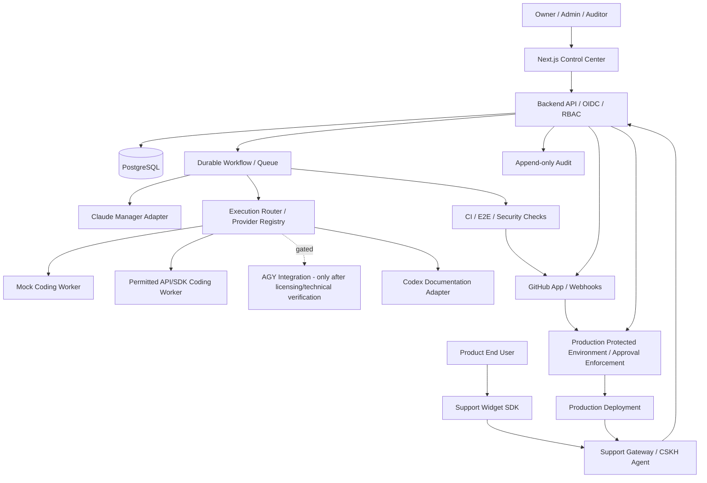
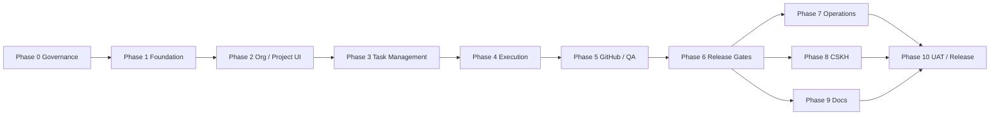

# AI DEV TEAM CONTROL CENTER — MASTER IMPLEMENTATION PLAN

**Version:** 1.0.0 (implementation baseline)  
**Ngày lập:** 25/11/2026 · **Timezone:** `Asia/Ho_Chi_Minh`  
**Product Owner / GitHub reviewer:** `residoken-wq`  
**Ngày phát hành đầu tiên dự kiến:** `2026-12-05` (**mốc mục tiêu, không phải cam kết release**)  
**Release train:** tối đa 01 lô/ngày/**project**, giờ chạy `CHƯA CẤU HÌNH`  
**SEV1/SEV2:** hotfix riêng, bắt buộc Owner duyệt từng lần trước production  
**Trạng thái:** SPECIFICATION APPROVED FOR IMPLEMENTATION PLANNING; **chưa** triển khai enforcement trên GitHub/n8n/CI.

> **Mục đích:** Tài liệu giao việc trực tiếp cho Claude AI Engineering Manager/Team Leader để xây Web App quản trị AI Dev Team. Đây là kế hoạch xây **sản phẩm Web Control Center**, không phải chỉ nâng cấp AGY MCP Router. Các phần được đề xuất thêm từ việc thiết kế sản phẩm được đánh dấu là **[THIẾT KẾ ĐỀ XUẤT]**; quyết định Owner đã xác nhận được đánh dấu **[OWNER APPROVED]**. Không tự suy diễn giá trị của thông số chưa cấu hình.

## 0. START HERE — Chỉ thị bắt buộc cho Claude Manager

1. Đọc toàn bộ file này, `RELEASE_POLICY_v1.0.1.md`, `approval-policy-v1.0.1.yaml`, source `AGY_MCP_Router_MVP_v0.1`, hai proposal AI Dev Team và AI Product Support. Nếu file không có trong workspace, đánh dấu `SOURCE_MISSING`, không tự khẳng định đã đọc.
2. Chạy **Phase 0** trước, kiểm kê repo, môi trường, credential permissions, công cụ và ràng buộc pháp lý; tạo ADR cho các quyết định thiết kế cần thiết. **Không** thực hiện thay đổi production.
3. Tạo GitHub Milestones/Epics/Issues từ Task Catalog phía dưới, giữ nguyên `Task ID`, scope, dependencies và acceptance criteria. Việc tạo issue chỉ được thực hiện nếu GitHub App/token đã được Owner cấp phép; nếu chưa thì xuất bản `issues-import.json`/CSV hoặc issue templates.
4. Mỗi task chạy qua trạng thái chuẩn: `BACKLOG → READY → ASSIGNED → RUNNING → CODE_REVIEW → QA → READY_FOR_RELEASE → DONE`; có nhánh `BLOCKED`, `FAILED`, `CANCELLED`, `AWAITING_OWNER_APPROVAL`. Không bỏ qua gate.
5. Luôn tạo feature branch/worktree, mở PR, đính kèm test evidence. Claude được review/giao task nhưng **không** tự duyệt production; GUI approval chỉ tạo request, production gate phải enforce từ backend và GitHub protected environment hoặc approval service đủ điều kiện.
6. Không dùng consumer AGY account trong embedded third-party orchestration hoặc account rotation cho tới khi **được xác minh quyền sử dụng phù hợp**. MVP chạy được với mock worker và adapter API/SDK được phép; integration AGY thật là optional, gated.
7. Sau mỗi milestone xuất: `STATUS_REPORT.md`, `RISKS.md`, `DECISION_LOG.md`, `TEST_EVIDENCE.md`, backlog cập nhật và links đến PR/artifacts.
8. Không tự khai báo task là `DONE` chỉ vì code chạy; phải đạt acceptance criteria, test tự động tương ứng và review.

### 0.1 Quyết định cố định và giá trị mở

| Thuộc tính | Giá trị / quy định | Loại |
|---|---|---|
| Product name | **AI Dev Team Control Center** | [THIẾT KẾ ĐỀ XUẤT] |
| Owner GitHub | `residoken-wq` | [OWNER APPROVED] |
| Release train | `daily`, tối đa một lô/project/ngày | [OWNER APPROVED] |
| First planned release date | `2026-12-05` | [OWNER APPROVED] |
| Timezone | `Asia/Ho_Chi_Minh` | [OWNER APPROVED] |
| Daily release time | `null` / CHƯA CẤU HÌNH | OPEN |
| Backup/Delegated approver | `null` / CHƯA CẤU HÌNH | OPEN; fail closed |
| Approval TTL | `null` / CHƯA CẤU HÌNH | OPEN; nếu không có TTL, vẫn invalidate khi artifact thay đổi |
| GitHub production reviewer | `residoken-wq` | [OWNER APPROVED], chưa cấu hình trên GitHub |
| GitHub required check | `claude-review` | Policy, chưa enforce |
| Production deploy | Owner approval khớp SHA+manifest digest+pipeline run | [OWNER APPROVED] |
| Codex Docs | Có trong target architecture; phase sau MVP core | [THIẾT KẾ ĐỀ XUẤT] |
| AI worker provider | Abstraction; provider được phép | OPEN, cần legal/licensing check |
| Target hosting domain, GitHub repo, subscription/billing | CHƯA CẤU HÌNH | OPEN |

### 0.2 Phạm vi MVP và ngoài phạm vi

**MVP-P0 bắt buộc:** Web App login/OIDC, tenant-aware project model, RBAC, quản lý tổ chức/role/agent/account/worker, projects, tasks/board, task dispatch qua mock adapter + execution service, status/log stream, GitHub read/integration, approval center, policy evaluation, audit events, dashboard, staging preview link, bảo vệ credentials.

**P1:** agent QA loop, auto worktrees/runner isolation, GitHub CI/CD automation, cost analytics, knowledge base, workflow designer v1, release train orchestration.

**P2:** end-user AI support/CSKH → ticket → bugfix; Codex docs/screenshots/video, multi-tenant customer-facing features.

**Không thuộc MVP:** cấp token consumer account cho người khác; auto bypass approval; remote desktop live streaming; visual workflow engine tùy ý có thể chạy shell; triển khai production tự động trước khi gate thực sự được kiểm chứng.

## 1. Product Vision & Success Criteria

**North star:** Owner nhìn thấy danh mục projects, trạng thái sprint/tasks, agent phụ trách, cost/usage, CI/PR/release, điểm đang blocked và những quyết định cần duyệt — trong một Web App. Owner có thể tạo/sửa AI org chart, bind agent ↔ provider credential ↔ runtime ↔ project, giao việc trực tiếp hoặc cho Claude Manager phân rã tự động; theo dõi toàn bộ vòng đời công việc và bằng chứng kỹ thuật.

**Personas:** Platform Owner; Project Owner (giai đoạn đầu cùng `residoken-wq`); AI Engineering Manager (Claude); AI Team Leader; AI Dev Worker; QA Agent; Documentation Agent; CSKH Agent; read-only Auditor; End-user (chỉ qua product support SDK).

**Use cases trọng yếu**

- UC-01: Owner đăng nhập, tạo Organization → Project → GitHub repo, kéo một agent đã cấu hình vào org chart.
- UC-02: Admin tạo agent instance `frontend-01`, chọn role Frontend Developer, bind adapter/credential reference và worker pool, chỉ cấp quyền project HULA ERP.
- UC-03: Owner nhập yêu cầu → Claude tạo plan/issues/criteria → Owner duyệt scope → workers code → Claude QA → PR.
- UC-04: Mỗi project có dashboard task, agent run log, PR, checks, screenshot/staging URL và release manifest.
- UC-05: Owner duyệt release/hotfix qua approval center; mỗi approval ràng buộc chính xác commit+manifest+pipeline run; thay đổi bất kỳ phải xin duyệt lại.
- UC-06: End-user gửi bug → CSKH phân loại và chuẩn hóa evidence → task engineering → fix/QA/release → thông báo end-user.
- UC-07: Sau release, Codex sinh docs, FAQ, screenshots, video được duyệt, lưu theo product version.

**KPI đánh giá:** % task có owner+criteria; % PR qua CI/QA; median time from report to triage; mean time to repair (MTTR); % production releases có Owner approval hợp lệ; approval mismatch rejected (target 100%); duplicate tickets; worker failure/retry; task lead time; monthly cost per project. Baseline/threshold phải đo trong pilot, không tự bịa số.

## 2. Kiến trúc mục tiêu



**Control plane:** Next.js UI + backend API + RBAC + org/project registry + policy + audit. **Execution plane:** queue/workflows + provider adapters + isolated workers + Git worktree + CI runner. **Data plane:** PostgreSQL, object storage (attachments/logs/videos), secrets manager, telemetry. **Security boundary:** untrusted user tickets/AI output không thể vượt qua RBAC/policy gates.

### 2.1 Tech stack đề xuất và quyết định cần ADR

| Lớp | Default đề xuất | ADR / lựa chọn thay thế |
|---|---|---|
| Frontend | Next.js App Router, TypeScript, Tailwind, shadcn/ui | Chốt version theo lockfile sau Phase 0 |
| Backend | NestJS + TypeScript + OpenAPI | FastAPI nếu team ưu tiên Python; **chọn đúng một** |
| Database | PostgreSQL + Prisma/Drizzle | Chốt ORM trong ADR |
| Workflow | Temporal **hoặc** BullMQ/Redis (MVP); không dùng cả hai tùy tiện | Temporal tốt cho long-running durable state; BullMQ nhẹ hơn |
| Agent integration | Versioned provider adapters + SDK/API hợp lệ | AGY gated, không phải hard dependency |
| GitHub | GitHub App, webhook signatures, checks, GitHub Actions | Least privilege |
| Identity | Microsoft Entra ID OIDC + app RBAC | Local dev auth chỉ ở development |
| Realtime | SSE / WebSocket event stream | Events bền vững trong DB/queue |
| Logs/metrics | OpenTelemetry + log/object store | Redact sensitive data |
| Storage | S3-compatible object store | Docs, video, evidence, screenshots |
| Deploy | Docker Compose dev; staging/prod tùy hạ tầng | Không assume production server |

**Tránh xây quá lớn sớm:** n8n có thể dùng cho notifications/Teams/connectors; lõi job queue và approval state cần transactional/durable, có idempotency và audit đầy đủ.

### 2.2 Điều kiện tích hợp provider

- Credential types: `API_KEY`, `SERVICE_ACCOUNT`, `OAUTH_MANAGED`, `LOCAL_CLI_PROFILE` (gated). Luôn lưu **secret reference**, không trả plaintext qua UI/API/logs.
- Provider account binding không đồng nghĩa chia sẻ subscription seat hoặc tự động account rotation; mỗi adapter phải có `license_approved`, `supported_execution_mode`, `credential_scope`, `last_verified_at`.
- AGY `-p`, JSON envelope, auth isolation trên máy Windows/Linux: test thực tế trên môi trường hợp lệ; nếu chưa pass thì chỉ dùng mock adapter.
- Claude review = quality check; không được dùng bot PR approval làm owner review. `claude-review` status check không tự thay thế GitHub human/environment approval.

## 3. Sơ đồ dữ liệu và bounded contexts

### 3.1 Core entities (tối thiểu)

| Entity / table | Trường cốt lõi | Constraints quan trọng |
|---|---|---|
| organizations | id, name, slug, status | slug unique |
| users | id, oidc_subject, github_login, status | identity unique; không dựa display name |
| org_memberships | org_id, user_id, role_id | unique(org,user,role) |
| roles | id, scope, name, permissions_json | scope `platform/org/project` |
| permissions | resource, action, constraints | default deny |
| agent_definitions | id, type, role_key, capability_set, version | role ≠ credential |
| agent_instances | id, definition_id, org_id, display_name, state | nhiều agent cùng definition |
| provider_accounts | id, provider, credential_ref, license_state | secret_ref only; không lưu token rõ |
| runtime_workers | id, adapter, node, capability, health, concurrency | least privilege + quarantine |
| agent_bindings | agent_instance_id, provider_account_id, runtime_worker_id | effective dates, audit |
| projects | id, org_id, name, slug, status | org-scoped |
| project_repositories | project_id, provider, repo_id, default_branch | ownership/permission validated |
| project_agent_assignments | project_id, agent_id, project_role, capacity | unique active assignment |
| milestones / sprints | id, project_id, date_range, status | one project scoped |
| tasks | id, project_id, epic_id, title, priority, severity, state, assignee_id | optimistic locking |
| task_dependencies | parent_task_id, depends_on_task_id | no cycles |
| agent_runs | task_id, worker_id, adapter_id, attempts, state, worktree, timestamps | idempotency key |
| run_events / run_artifacts | run_id, seq, type, payload_ref | append only; sanitize |
| integrations | project_id, type, config_ref, health | webhook secret ref |
| pull_requests | repo_id, task_id, number, head_sha, checks_state | dedupe webhook events |
| workflow_definitions / workflow_runs | version, trigger, state, correlation_id | durable + replay-safe |
| release_manifests | project_id, digest, target_sha, run_id, item_list | immutable after approval |
| release_approvals | manifest_id, approver_id, decision, digest, sha, pipeline_run_id, timestamp | revoke on mismatch |
| deployments | manifest_id, env, run_id, result, healthcheck | immutable history |
| support_tickets | project_id, user_ref, kind, severity, evidence_ref, state | tenant-aware evidence ACL |
| documentation_artifacts | project_id, release_id, version, asset_ref, review_state | tied to release version |
| audit_events | actor, action, resource, before_hash, after_hash, timestamp, correlation | append-only with retention |
| usage_cost_events | run_id, provider, model, tokens, cost_estimate, currency | distinguish estimate/billed |

### 3.2 Key invariants

1. Không cross-tenant leak: mọi query, task, run, file, notification phải gắn `org_id`, `project_id` và policy kiểm soát.
2. Role/agent/account/worker là bốn khái niệm độc lập; đổi account không làm thay đổi quyền role.
3. Không có task execution nếu worker không match capability + allowed project + license state.
4. Một worktree chỉ do một running task/worker nắm lock; mỗi task idempotency key duy nhất.
5. Phải kiểm tra SHA/manifest digest/pipeline run **tại thời điểm deploy**, không chỉ tại thời điểm click Approve.
6. Các thay đổi policy/role/credential/release phải tạo audit event, không xóa âm thầm.
7. Video/screenshot/session replay phải masking dữ liệu cá nhân và có chính sách retention.

## 4. API Contract và Event Contract

**API namespaces:** `/api/v1/auth`, `/organizations`, `/members`, `/roles`, `/agents`, `/provider-accounts`, `/workers`, `/projects`, `/tasks`, `/runs`, `/integrations/github`, `/approvals`, `/releases`, `/support/tickets`, `/docs`, `/audit`, `/usage`.

**Minimum endpoints:**

- `GET /me`, `GET /permissions` — identity & effective permissions.
- `POST/GET/PATCH /organizations`, `POST/GET /agents`, `POST /agent-bindings` — org chart + mapping.
- `POST/GET /projects`, `POST /projects/:id/repositories` — project + repo mapping.
- `POST/GET/PATCH /tasks`, `POST /tasks/:id/dispatch`, `POST /tasks/:id/cancel`, `GET /runs/:id/events`.
- `POST /integrations/github/webhook` — signature verified; replay-protected; event dedupe.
- `GET /releases/:id/manifest`, `POST /releases/:id/request-approval`, `POST /approvals/:id/decision` — trusted identity and exact binding.
- `POST /support/tickets`, `POST /support/tickets/:id/triage`, `GET /projects/:id/metrics`.

**Events (versioned):** `task.created.v1`, `task.assigned.v1`, `agent.run.started.v1`, `agent.run.finished.v1`, `github.pr.updated.v1`, `qa.check.completed.v1`, `release.manifest.created.v1`, `release.approval.requested.v1`, `release.approval.invalidated.v1`, `deployment.completed.v1`, `support.ticket.triaged.v1`, `docs.artifact.published.v1`.

**Event envelope:** `event_id`, `event_type`, `schema_version`, `occurred_at`, `org_id`, `project_id`, `correlation_id`, `causation_id`, `actor`, `payload`, `idempotency_key`.

### 4.1 Task JSON contract (mẫu)

```json
{
  "schema_version": "1.0",
  "task_id": "HULA-123",
  "org_id": "org-pace",
  "project_id": "hula-erp",
  "task_type": "bugfix",
  "title": "Fix validation Sales Order",
  "requirements": ["Không cho lưu khi số lượng <= 0"],
  "acceptance_criteria": ["Unit test pass", "E2E validation pass"],
  "allowed_paths": ["apps/web/src/features/orders/**"],
  "forbidden_paths": [".env*", "secrets/**"],
  "target_branch": "ai/HULA-123",
  "base_sha": "<resolved-at-dispatch>",
  "assigned_agent_id": "frontend-01",
  "expected_outputs": ["git_diff", "test_report", "developer_report"],
  "approval_required": false
}
```

`allowed_paths` và lời nhắc prompt chỉ là lớp chính sách logic; phải có OS/repo/token isolation để cưỡng chế thực tế.

## 5. UI/UX Information Architecture

**Global navigation:** Overview / Organizations / AI Agents / Provider Accounts / Worker Pools / Projects / Tasks / Approvals / Workflows / Integrations / Usage & Cost / Audit / Settings.

**Project workspace:** Overview, Kanban, Sprint/Backlog, Tasks, Assigned Agents, Activity Timeline, GitHub PR & Checks, QA Evidence, Staging Preview, Releases & Approvals, Documentation, Support Tickets, Project Settings.

**Thiết kế màn hình:**

- **Dashboard:** project count, active workers, queued/running/blocked tasks, PRs waiting review, pending owner approvals, daily releases, costs, recent incidents; filters theo org/project/time/severity.
- **Org Chart:** cây hierarchy + drag/drop gán role; side panel agent details, capability, account binding, project membership, least privilege; audit mọi thay đổi.
- **Agent Registry:** searchable list, provider/adapter/credential reference, worker pool, health, version, last job, quotas/usage nếu được provider hỗ trợ, không show secrets.
- **Project Board:** Kanban + details drawer có requirements, acceptance criteria, logs, branch/PR/checks và link staging.
- **Task Run Detail:** real-time event timeline, stdout/stderr sanitized, diff summary, artifacts, retries, token/cost estimate, cancel/pause.
- **Approval Center:** hai queue release train/hotfix; manifest items, digest, target SHA, CI, staging, rollback, approver identity, immutable decision receipt.
- **Release Calendar:** tối đa 1 batch/ngày/project; ngày đầu dự kiến 05/12/2026, **chưa có giờ tự động**; để trạng thái `SCHEDULE_NOT_CONFIGURED`.
- **Reports:** lead time, pass/fail, agent utilization, bug resolution, cost trends; export CSV/Markdown/PDF về sau.

**Design system:** responsive desktop-first, a11y WCAG 2.2 AA target, light/dark, loading/empty/error/permission denied states, timezone-aware timestamps, no misleading `Online` unless heartbeat verified.

## 6. Release governance — chính sách bắt buộc

### 6.1 Daily train SEV3/SEV4

`READY_FOR_RELEASE → BUILD_MANIFEST → VALIDATE_CI/QA/UAT/STAGING → AWAITING_OWNER_APPROVAL → VALIDATE_MANIFEST_SHA_RUN → DEPLOY → HEALTHCHECK → CLOSED`.

- Tối đa **1 lô/ngày/project**; release date đầu tiên dự kiến **05/12/2026**; execution time vẫn `null`. Không tạo job daily tự động cho đến khi được Owner cấu hình giờ và deploy controller đã được nghiệm thu.
- Release manifest gồm PR IDs, SHAs, artifact digests, check results, deploy workflow run, env, rollback instructions; digest immutable.
- Owner `residoken-wq` duyệt production theo trusted GitHub protected environment hoặc approval record được backend/CI xác thực, không qua Teams/chat bot.
- SHA, manifest, artifact hoặc pipeline run thay đổi => invalidate approval, quay lại `AWAITING_OWNER_APPROVAL`.
- Không có approval hoặc Owner vắng mặt => **fail closed**.

### 6.2 Emergency hotfix SEV1/SEV2

`INCIDENT_OPEN → HOTFIX_BRANCH hotfix/<incident_id> → TARGETED_TESTS → HOTFIX_QA → AWAITING_SEPARATE_OWNER_APPROVAL → DEPLOY → HEALTHCHECK → POSTMORTEM_DRAFT`.

- Không tái sử dụng approval release train, không tự approve. Phải gắn `incident_id`, severity justification, targeted tests, rollback plan và owner decision record.
- Khi Owner vắng mặt: thông báo escalation và giữ chờ duyệt; **không** tự cấp quyền cho AI, không auto bypass ngay cả SEV1.
- Thay đổi auth/permission, secrets, destructive DB, production data, privacy/security/critical infra => approval riêng theo policy.

### 6.3 Required enforcement & acceptance tests

1. CI fail => PR không merge / release không deploy.
2. `claude-review` thiếu/fail => merge blocked theo ruleset, source check phải được pin.
3. Approval bởi AI/bot hoặc user không được cấp quyền => từ chối.
4. Manifest/SHA/pipeline run mismatch sau duyệt => approval invalidated và deploy blocked.
5. Không có Owner approval => production blocked cả train lẫn hotfix.
6. SEV1/SEV2 không lọt vào normal train; SEV3/4 không đi luồng hotfix tùy tiện.
7. Replay webhook/event/approval request => không deploy trùng.
8. Thử revoke Owner quyền giữa chừng => không deploy bằng approval cũ không còn hợp lệ.

**Trạng thái chính sách cần tách:** `POLICY_APPROVED`, `IMPLEMENTATION_PENDING`, `ENFORCEMENT_VERIFIED`. Chỉ đặt `ENFORCEMENT_VERIFIED` khi có bằng chứng test trên staging/production-like setup.

## 7. Phân quyền và bảo mật

| Actor | Read | Write | Approve | Deploy production |
|---|---|---|---|---|
| Owner | Trong tổ chức | Config, policy, task, release | Owner-level approvals | Qua trusted protected gate |
| Admin | Theo scope | Users/agents/workers không vượt Owner policy | Không tự thay Owner | Không |
| AI Manager | Assigned projects | Plans/issues/comments/review status | Không | Không |
| Team Leader | Assigned tasks | Assign/subtasks/branch requests | Không | Không |
| Coding Worker | Scoped repo + worktree | Feature branch/PR trong allowlist | Không | Không |
| QA Agent | Repo diff + test evidence | Check/status qua trusted workflow | Không | Không |
| Docs Agent | Approved release snapshot | Docs branch/PR/artifacts | Không | Không |
| CSKH Agent | Product KB + sanitized evidence | Support tickets/triage | Không | Không |
| Auditor | Audit/report read-only | Không | Không | Không |

**Security baseline:** OIDC PKCE/session protection; CSRF defenses; strict RBAC/ABAC at API; secret vault; webhook HMAC/signature; outbound network restrictions for runners; repo write tokens short-lived; vulnerability/dependency scan; runtime isolation; artifact scanning; log redaction; backup/restore drill; retention and privacy policy; CSP/security headers; SAST/SCA; no public exposure of internal tools. Agent-generated output and ticket text are untrusted (prompt injection defense).

## 8. Definition of Ready / Done

**DoR:** scope rõ, acceptance criteria đo được, dependencies/owner, data access, expected outputs, risk/severity, threat model nếu sensitive, test plan và branch policy.

**DoD mỗi task:** code/docs committed trên feature branch, PR linked to task, lint/typecheck/unit/integration phù hợp, security checks, reviewer feedback resolved, evidence attached, docs/ADR updated nếu cần, acceptance criteria demonstrated; nếu không chạm code thì report/decision record phải có evidence.

**DoD mỗi phase:** deliverables được lưu repo, tests pass, UX reviewed (nếu có), logging/observability, rollout/rollback, milestone demo cho Owner, các quyết định còn mở nêu rõ, không tự deploy production.

## 9. Phase plan — mục tiêu và exit gates

| Phase | Tên | Mục tiêu | Exit gate |
|---|---|---|---|
| 0 | Discovery & Governance | Kiểm kê source/hạ tầng, chốt ADR, risk & compliance | Owner duyệt baseline + open decisions |
| 1 | Foundation & Security | Monorepo, CI, auth, DB, audit, secret mgmt | Dev/staging skeleton pass tests |
| 2 | Control Center UI | Layout, org/role/agent/account/worker/project CRUD | Owner demo workflows không cần AI thật |
| 3 | Project & Task Management | Kanban, sprint, dependencies, task dispatch contracts | End-to-end create/assign/track task |
| 4 | Agent Runtime & Router | Queue, adapters, worker isolation, logs, mock/allowed API | Worker lifecycle E2E pass |
| 5 | GitHub / Claude QA / DevOps | App/webhooks, PR/CI/review loop, worktrees | PR to staging demonstrated |
| 6 | Release & Approval | Daily train, hotfix, protected env, exact approval binding | 8 negative/positive gate tests pass |
| 7 | Observability & Ops | Dashboards, metrics, cost, incident/runbook | Operational readiness signoff |
| 8 | End-user Support / CSKH | Product widget, KB, triage, tickets, feedback loop | Bug ticket → engineering workflow |
| 9 | Codex Docs & Training | Docs, screenshots, tutorial video, KB update | Release-linked docs/videos with QA |
| 10 | Hardening & Pilot Release | UAT, security, DR, pilot, go/no-go | Owner final approval; only then prod |

**Không ấn định sprint duration / manpower / ngày hoàn thành từng phase khi chưa đo được velocity.** Mốc 05/12/2026 chỉ là release dự kiến; nếu compliance/gates chưa đạt, phải đề nghị dời mốc, tuyệt đối không bypass.

### Phase 0 — Discovery & Governance

**Goal:** Discovery & Governance. **Deliverables:** see task table; tất cả artefact phải nằm trong repository có version và linked issue/PR.

| Task ID | Task chi tiết | Responsible | Depends on | Output | Acceptance criteria |
|---|---|---|---|---|---|

| P0-01 | Kiểm kê tài liệu gốc và source/router v0.1 | Claude Manager | — | SOURCE_INVENTORY.md | Liệt kê file/version/checksum, missing sources; phân biệt mock-tested và live-tested |

| P0-02 | Kiểm kê repository, hosting, domain, CI, accounts | DevOps Lead | P0-01 | ENVIRONMENT_INVENTORY.md | Không ghi secret; đánh dấu thông số chưa cấu hình |

| P0-03 | Threat model multi-agent/multi-project | Security Lead | P0-01 | THREAT_MODEL.md | Cover prompt injection, creds, tenant leak, CI bypass, audit tampering |

| P0-04 | License/commercial terms matrix cho Anthropic/Google/AGY | Legal + Architect | P0-01 | PROVIDER_COMPLIANCE.md | Trạng thái approved/unverified/prohibited per provider; không suy diễn |

| P0-05 | Chốt ADR framework/backend/queue/ORM | Architect | P0-02 | ADR-001..004.md | Mỗi ADR có tradeoffs, reason, rollback, Owner visibility |

| P0-06 | Chốt RBAC matrix và dữ liệu/retention | Security + Owner | P0-03 | RBAC_MATRIX.md | Owner approval required; default deny; tenant scoping |

| P0-07 | Thiết kế wireframes/UX flows | Product Designer | P0-01 | UX_FLOWS.md | Org chart/project/task/approval journeys reviewed |

| P0-08 | Tạo project backlog/issues/milestones | Claude Manager | P0-05 | ISSUE_IMPORT.json | Giữ IDs, dependencies, phase labels, PR references |

| P0-09 | Owner baseline signoff | Owner | P0-04,P0-06,P0-08 | DECISION_LOG.md | Ghi approval scope; không đồng nghĩa approve production |

**Phase 0 gate:** Không đóng phase khi còn task blocker/critical security hoặc chưa có evidence cho acceptance criteria; phải xuất `PHASE_0_REPORT.md`, cập nhật `DECISION_LOG.md` và `RISKS.md`.

### Phase 1 — Foundation & Security

**Goal:** Foundation & Security. **Deliverables:** see task table; tất cả artefact phải nằm trong repository có version và linked issue/PR.

| Task ID | Task chi tiết | Responsible | Depends on | Output | Acceptance criteria |
|---|---|---|---|---|---|

| P1-01 | Bootstrap monorepo/web/backend/shared packages | Fullstack Dev | P0-05 | Repo skeleton | Install/build dev pass, lint/test commands documented |

| P1-02 | Docker Compose dev environment | DevOps | P1-01 | compose.yaml/.env.example | One-command local boot; no secrets committed |

| P1-03 | OpenAPI schemas + SDK client generation | Backend Dev | P1-01 | openapi.yaml | Contract tests validate schema; error formats |

| P1-04 | Database schema, migrations and seed | Backend Dev | P1-01,P0-06 | Migrations/ERD | Idempotent seed; rollback migration tested |

| P1-05 | OIDC with Entra ID and session handling | Security Dev | P1-01 | Auth module | Unauthenticated rejected; session expiry; dev-only mock isolated |

| P1-06 | RBAC/ABAC policy middleware | Security Dev | P1-05,P1-04 | Policy module | Negative tests on cross-org, cross-project, role spoofing |

| P1-07 | Secret references, vault interface, rotation hooks | Security Dev | P1-02 | CredentialVault adapter | Secret values never appear in API/log/browser |

| P1-08 | Append-only audit store, correlation IDs | Backend Dev | P1-04 | Audit module | Actions logged; tamper-evident controls specified |

| P1-09 | CI pipeline lint/typecheck/unit/SCA/SAST | DevOps | P1-01 | GitHub workflows | Required checks defined; no bypass admin default |

| P1-10 | Backup/restore & data retention baseline | DevOps | P1-04 | RUNBOOK_BACKUP.md | Restore rehearsal on nonproduction instance |

| P1-11 | Global error-handling, tracing, health probes | Backend Dev | P1-01 | Health/trace middleware | Readiness/liveness and request tracing pass |

**Phase 1 gate:** Không đóng phase khi còn task blocker/critical security hoặc chưa có evidence cho acceptance criteria; phải xuất `PHASE_1_REPORT.md`, cập nhật `DECISION_LOG.md` và `RISKS.md`.

### Phase 2 — Control Center UI & Organization

**Goal:** Control Center UI & Organization. **Deliverables:** see task table; tất cả artefact phải nằm trong repository có version và linked issue/PR.

| Task ID | Task chi tiết | Responsible | Depends on | Output | Acceptance criteria |
|---|---|---|---|---|---|

| P2-01 | App shell/sidebar/header/route guards | Frontend Dev | P1-05 | Web shell | Responsive; OIDC; unauthorized navigation blocked |

| P2-02 | Overview dashboard initial widgets | Frontend Dev | P2-01,P1-04 | Dashboard page | Real API loading/empty/error states; no fictitious production status |

| P2-03 | Organization CRUD and membership | Fullstack Dev | P1-06 | Org pages/API | Scoped permissions; optimistic updates rollback |

| P2-04 | Role/permission editor + policy preview | Fullstack Dev | P2-03 | RBAC UI | Deny escalations; audit all updates |

| P2-05 | Agent definitions & instances CRUD | Fullstack Dev | P2-03 | Agent registry | Role, capabilities, versions distinct from credentials |

| P2-06 | Visual org chart and role assignment | Frontend Dev | P2-04,P2-05 | Org chart | Hierarchy change saved, validated, audit logged |

| P2-07 | Provider account registry secret refs | Fullstack Dev | P1-07,P2-05 | Provider account screen | No plaintext tokens; licensing state visible |

| P2-08 | Worker pool inventory + health placeholders | Fullstack Dev | P2-05 | Workers screen | Real heartbeat/unknown state; no pretend online |

| P2-09 | Bind agent-account-worker-project rules | Backend Dev | P2-07,P2-08 | Binding API/UI | Reject unlicensed/unhealthy/incompatible bindings |

| P2-10 | Project CRUD, environments, repository mapping | Fullstack Dev | P2-03 | Project registry | Repo validation; org isolation; audit |

| P2-11 | Settings, profile, locale, accessibility | Frontend Dev | P2-01 | Settings pages | Keyboard navigation, a11y checks |

| P2-12 | Org/agent/project authorization E2E tests | QA Agent | P2-03,P2-09,P2-10 | Test evidence | Cross-tenant deny and assigned-project access verified |

**Phase 2 gate:** Không đóng phase khi còn task blocker/critical security hoặc chưa có evidence cho acceptance criteria; phải xuất `PHASE_2_REPORT.md`, cập nhật `DECISION_LOG.md` và `RISKS.md`.

### Phase 3 — Projects & Task Management

**Goal:** Projects & Task Management. **Deliverables:** see task table; tất cả artefact phải nằm trong repository có version và linked issue/PR.

| Task ID | Task chi tiết | Responsible | Depends on | Output | Acceptance criteria |
|---|---|---|---|---|---|

| P3-01 | Epics/milestones/sprints schema/API | Backend Dev | P2-10 | Planning API | Project-scoped; pagination, audit |

| P3-02 | Task schema, CRUD and status transitions | Backend Dev | P3-01 | Task API | Illegal transitions rejected; idempotency keys |

| P3-03 | Task dependency DAG validation | Backend Dev | P3-02 | Dependency engine | Cycle detection; blocked tasks cannot dispatch |

| P3-04 | Kanban with filters, drag/drop, task drawer | Frontend Dev | P3-02 | Project board | Server-enforced transitions, preserve scroll/filter state |

| P3-05 | Agent assignment & capacity policy | Fullstack Dev | P3-02,P2-09 | Task assignment UI/API | No assignment if role/capability/project mismatch |

| P3-06 | Task contract JSON schema and prompts | Claude Manager | P3-02 | task.schema.json/prompts | Schema validated; forbidden paths & criteria included |

| P3-07 | Task activity timeline/comments/attachments | Fullstack Dev | P3-02,P1-08 | Timeline | Events immutable order, sanitized attachments |

| P3-08 | Global task search/filter + project stats | Fullstack Dev | P3-04 | Task search | Filters org/project/assignee/state; RBAC respected |

| P3-09 | Manual dispatch, pause, cancel requests UI | Frontend Dev | P3-05 | Dispatch controls | Confirm critical actions, only authorized operator |

| P3-10 | Task E2E acceptance flows | QA Agent | P3-04,P3-07 | QA evidence | Create→assign→block→ready, no access bypass |

**Phase 3 gate:** Không đóng phase khi còn task blocker/critical security hoặc chưa có evidence cho acceptance criteria; phải xuất `PHASE_3_REPORT.md`, cập nhật `DECISION_LOG.md` và `RISKS.md`.

### Phase 4 — Execution Runtime & MCP Router Evolution

**Goal:** Execution Runtime & MCP Router Evolution. **Deliverables:** see task table; tất cả artefact phải nằm trong repository có version và linked issue/PR.

| Task ID | Task chi tiết | Responsible | Depends on | Output | Acceptance criteria |
|---|---|---|---|---|---|

| P4-01 | Design provider adapter interface | Architect | P0-04,P3-06 | IWorkerAdapter SDK | Capabilities/auth/license metadata; mock fallback |

| P4-02 | Durable queue state machine and scheduler | Backend Dev | P4-01,P1-04 | Queue engine | Restart recovery, at-least-once delivery with dedupe |

| P4-03 | Mock coding worker for integration tests | Backend Dev | P4-01 | Mock adapter | Deterministic outputs, failures, cancellations |

| P4-04 | Worker leases, heartbeat, concurrency limits | Backend Dev | P4-02 | Worker registry | Lease expiry handling and orphaned job recovery |

| P4-05 | Git worktree manager / locks / cleanup | DevOps | P4-04 | Worktree service | No shared worktree; no main branch modification |

| P4-06 | Isolated runner images, UID, filesystem/network policy | Security/DevOps | P4-04 | Runner templates | No docker.sock/secrets; egress and ACL tests |

| P4-07 | Run logs, artifacts, stream, cancellation | Fullstack Dev | P4-02 | Run detail UI | Redacted real-time logs; cancel kills subprocess tree |

| P4-08 | Retry/backoff, timeout, circuit breaker, DLQ | Backend Dev | P4-02 | Run policies | Failure paths deterministic; no infinite retry |

| P4-09 | Integrate Claude Manager via approved API/SDK | Agent Integrator | P4-01,P0-04 | Manager adapter | Authenticates, schema-valid result, no deployment privileges |

| P4-10 | Integrate a permitted coding API/SDK adapter | Agent Integrator | P4-01,P0-04 | Coding adapter | License check, min perms, explicit account binding |

| P4-11 | AGY CLI experimental compatibility test (gated) | DevOps | P4-01,P0-04 | AGY_COMPAT_TEST.md | Only if provider terms allow; verify flags/JSON/login/exit codes |

| P4-12 | Wrap existing router v0.1 as legacy adapter (optional) | Backend Dev | P4-11 | Adapter bridge | Only after legal/security clearance, not required for MVP |

| P4-13 | Multi-worker contention/load/failure testing | QA/DevOps | P4-04,P4-07 | Load report | No duplicate writes, stable worktree locks |

**Phase 4 gate:** Không đóng phase khi còn task blocker/critical security hoặc chưa có evidence cho acceptance criteria; phải xuất `PHASE_4_REPORT.md`, cập nhật `DECISION_LOG.md` và `RISKS.md`.

### Phase 5 — GitHub Integration & AI QA

**Goal:** GitHub Integration & AI QA. **Deliverables:** see task table; tất cả artefact phải nằm trong repository có version và linked issue/PR.

| Task ID | Task chi tiết | Responsible | Depends on | Output | Acceptance criteria |
|---|---|---|---|---|---|

| P5-01 | Register GitHub App + permission matrix | DevOps | P0-04,P1-07 | GitHub App config | Least privilege, installation verified by Owner |

| P5-02 | Webhook receiver signature/replay/dedupe | Backend Dev | P5-01 | Webhook API | Tampered & replayed events rejected |

| P5-03 | Sync repos/issues/PR/checks/status | Backend Dev | P5-02 | GitHub sync jobs | Consistent eventual sync and retry |

| P5-04 | Generate issue from approved task contract | Claude Manager | P3-06,P5-03 | Issue template | Task ID, criteria, security boundaries present |

| P5-05 | Create feature branch/worktree & PR linkage | DevOps | P4-05,P5-03 | PR lifecycle | PR carries task ID and base/head SHA |

| P5-06 | Claude code-review adapter and structured verdict | Agent Integrator | P4-09,P5-05 | Review reports | Clear PASS/CHANGES_REQUIRED/INCONCLUSIVE evidence |

| P5-07 | Trusted claude-review status check publishing | DevOps | P5-06 | Check workflow | Source app pinning, cannot spoof PASS |

| P5-08 | Auto fix-review loop capped retries | Backend Dev | P5-06,P4-08 | QA loop | Retry ceiling; BLOCKED with feedback and human escalation |

| P5-09 | CI + staging deploy + smoke/E2E | DevOps | P5-07 | Staging pipeline | Preview URL & artifacts accessible only authorized |

| P5-10 | Security scans/branch rulesets validation | Security/QA | P5-09 | Ruleset evidence | Bot approval cannot substitute required human gate |

| P5-11 | Project GitHub/PR/checks UI | Frontend Dev | P5-03 | PR dashboard | Display actual checks, SHA, failures |

**Phase 5 gate:** Không đóng phase khi còn task blocker/critical security hoặc chưa có evidence cho acceptance criteria; phải xuất `PHASE_5_REPORT.md`, cập nhật `DECISION_LOG.md` và `RISKS.md`.

### Phase 6 — Release Train, Hotfix, Human Approval

**Goal:** Release Train, Hotfix, Human Approval. **Deliverables:** see task table; tất cả artefact phải nằm trong repository có version và linked issue/PR.

| Task ID | Task chi tiết | Responsible | Depends on | Output | Acceptance criteria |
|---|---|---|---|---|---|

| P6-01 | Import policy v1.0.1 & versioned evaluator | Backend Dev | P1-06,P5-09 | Policy engine | Fail closed on missing/unrecognized policy |

| P6-02 | Release manifest builder + SHA/digest | Backend Dev | P6-01,P5-03 | Immutable manifest | Stable digest with deterministic canonicalization |

| P6-03 | Daily train aggregator per project | Backend Dev | P6-02 | Train scheduler | No >1 train/day/project; no runtime until time configured |

| P6-04 | Hotfix workflow incident/branch/targeted QA | Backend Dev | P6-01,P5-09 | Hotfix workflow | hotfix/<incident_id>; separate approval |

| P6-05 | Approval request/decision API and receipts | Backend Dev | P6-02,P1-08 | Approval service | Trusted Owner identity, immutable receipt |

| P6-06 | Approval Center UX and pending queues | Frontend Dev | P6-05 | Approval screens | Diff, SHA, digest, pipeline run, rollback visible |

| P6-07 | GitHub protected production environment | DevOps | P6-05 | Environment settings | Reviewer residoken-wq, self-review policy checked |

| P6-08 | CI deploy gate bound to SHA+digest+run | DevOps | P6-02,P6-07 | Deploy protection | Mismatch approval rejects at runtime |

| P6-09 | Approval invalidation & expiration path | Backend Dev | P6-05 | Invalidation events | SHA/manifest/run change instantly revokes eligibility |

| P6-10 | Emergency escalation notification only | Backend Dev | P6-04 | Notification adapters | Teams never records approval; owner absent -> pause |

| P6-11 | Post-deploy healthcheck/rollback/postmortem | DevOps | P6-08 | Runbooks | Failure rollback and incident evidence preserved |

| P6-12 | Acceptance tests for 8 policy gates | QA/Security | P6-08,P6-09 | POLICY_TEST_EVIDENCE.md | All 8 tests from §6.3 pass; Owner signoff |

**Phase 6 gate:** Không đóng phase khi còn task blocker/critical security hoặc chưa có evidence cho acceptance criteria; phải xuất `PHASE_6_REPORT.md`, cập nhật `DECISION_LOG.md` và `RISKS.md`.

### Phase 7 — Operational Dashboards & Reliability

**Goal:** Operational Dashboards & Reliability. **Deliverables:** see task table; tất cả artefact phải nằm trong repository có version và linked issue/PR.

| Task ID | Task chi tiết | Responsible | Depends on | Output | Acceptance criteria |
|---|---|---|---|---|---|

| P7-01 | Agent live status & heartbeat view | Frontend Dev | P4-04,P4-07 | Agent monitor | Shows unknown/offline/queued/running precisely |

| P7-02 | Task execution metrics/SLIs and alerts | SRE | P4-07 | Dashboards | Latency, failure, stuck tasks, backlog measured |

| P7-03 | Usage/token/cost estimation pipeline | Backend Dev | P4-01 | Usage analytics | Separate estimates from provider invoices |

| P7-04 | Executive project/portfolio dashboard | Frontend Dev | P3-08,P7-02 | Portfolio view | Filters project/org/time; drilldown to evidence |

| P7-05 | Approval/release calendar + audit explorer | Frontend Dev | P6-06,P1-08 | Release/audit UI | Owner can export immutable receipts |

| P7-06 | Notification rules & digest (Teams optional) | Backend Dev | P7-02 | Notification service | Dedup, no sensitive leak, never as approval source |

| P7-07 | Operational runbook, DR/restore test | SRE | P1-10,P7-02 | OPS_RUNBOOK.md | Recovery simulated, alert escalation tested |

| P7-08 | Load test & performance budgets | QA/SRE | P7-04 | Performance report | Document throughput limits without invented SLA |

**Phase 7 gate:** Không đóng phase khi còn task blocker/critical security hoặc chưa có evidence cho acceptance criteria; phải xuất `PHASE_7_REPORT.md`, cập nhật `DECISION_LOG.md` và `RISKS.md`.

### Phase 8 — End-user Support & CSKH Loop

**Goal:** End-user Support & CSKH Loop. **Deliverables:** see task table; tất cả artefact phải nằm trong repository có version và linked issue/PR.

| Task ID | Task chi tiết | Responsible | Depends on | Output | Acceptance criteria |
|---|---|---|---|---|---|

| P8-01 | Product registry / widget SDK specification | Product/Backend | P2-10 | Support SDK spec | Tenant/project/version mapping; safe identity |

| P8-02 | Embedded chat UI and channel gateway | Frontend Dev | P8-01 | Support widget | Secure embed; conversation continuity |

| P8-03 | Product/version-scoped knowledge base RAG | AI Integrator | P8-01 | KB service | Cite approved docs; no cross-tenant retrieval |

| P8-04 | Bug intake evidence and PII masking | Backend Dev | P8-02 | Ticket API/schema | Consent/retention; no secrets/PII in tickets by default |

| P8-05 | CSKH triage FAQ/user-error/bug/feature/security | AI Integrator | P8-03,P8-04 | Triage policy | Confidence/uncertainty and escalation handled |

| P8-06 | Sentry/PostHog optional evidence connectors | Backend Dev | P8-04 | Evidence connectors | Private replay access, masking, license check |

| P8-07 | Duplicate detection and ticket grouping | Backend Dev | P8-05 | Ticket dedupe | Original tickets preserved & linked |

| P8-08 | Authorized ticket → engineering task bridge | Backend Dev | P8-05,P3-02 | Task bridge | No direct repo writes from untrusted ticket content |

| P8-09 | Incident severity routing, SLA and human override | CSKH Lead | P8-08 | Escalation rules | SEV1/2 follow hotfix approval, not auto deploy |

| P8-10 | Status feedback to end user and closure | Fullstack Dev | P8-08,P6-11 | Notification workflow | No false “fixed” until deployed & verified |

| P8-11 | Pilot HULA ERP end-to-end bug journey | QA/Product | P8-10 | Pilot report | User report→triage→task→QA→approved release→closure |

**Phase 8 gate:** Không đóng phase khi còn task blocker/critical security hoặc chưa có evidence cho acceptance criteria; phải xuất `PHASE_8_REPORT.md`, cập nhật `DECISION_LOG.md` và `RISKS.md`.

### Phase 9 — Documentation & Training Automation

**Goal:** Documentation & Training Automation. **Deliverables:** see task table; tất cả artefact phải nằm trong repository có version và linked issue/PR.

| Task ID | Task chi tiết | Responsible | Depends on | Output | Acceptance criteria |
|---|---|---|---|---|---|

| P9-01 | Codex docs adapter via permitted SDK/API | Agent Integrator | P4-01,P0-04 | Docs adapter | Approved execution mode; no untrusted prod access |

| P9-02 | Release-linked docs/FAQ/change log templates | Tech Writer | P9-01,P6-02 | Docs templates | References exact deployed version/SHA |

| P9-03 | Playwright guided screenshot/video capture | QA/Automation | P5-09,P9-02 | Capture worker | Mask sensitive data; stable demo dataset |

| P9-04 | FFmpeg processing/subtitle/TTS integration | Media Dev | P9-03 | Video pipeline | Audio rights/consent, captions, deterministic assets |

| P9-05 | Documentation review/approval & publishing | Fullstack Dev | P9-02 | Docs Studio | Review required; approved artifacts immutable/versioned |

| P9-06 | Feedback from CSKH to knowledge base | AI Integrator | P8-05,P9-05 | KB refresh workflow | Curated edits; evaluation prevents hallucinated instructions |

| P9-07 | Docs/video pilot for product release | QA | P9-05,P9-04 | Docs pilot report | User can follow guide; all screenshots match release |

**Phase 9 gate:** Không đóng phase khi còn task blocker/critical security hoặc chưa có evidence cho acceptance criteria; phải xuất `PHASE_9_REPORT.md`, cập nhật `DECISION_LOG.md` và `RISKS.md`.

### Phase 10 — Hardening, UAT & Initial Release

**Goal:** Hardening, UAT & Initial Release. **Deliverables:** see task table; tất cả artefact phải nằm trong repository có version và linked issue/PR.

| Task ID | Task chi tiết | Responsible | Depends on | Output | Acceptance criteria |
|---|---|---|---|---|---|

| P10-01 | Security penetration/abuse tests | Security | P6-12,P8-11 | Security report | Fix critical/high before go-live |

| P10-02 | Cross-tenant and data isolation regression | QA | P8-11,P9-07 | Isolation report | No data leaks; project scoping exhaustive |

| P10-03 | Production-like chaos/restart/retry tests | SRE | P7-07 | Resilience report | No duplicate run/release; crash recovery |

| P10-04 | Owner acceptance/UAT demo and signoff | Owner | P10-01,P10-02,P10-03 | UAT receipt | All core use cases and policy evidence accepted |

| P10-05 | Release manifest / rollback / go-no-go | Claude Manager | P10-04 | Release dossier | SHA+digest+run bound; exceptions documented |

| P10-06 | Production environment gate verification | DevOps + Owner | P10-05 | Gate evidence | residoken-wq reviewer; no bypass; approve real run |

| P10-07 | Pilot initial release candidate evaluation | Owner | P10-06 | GO_NO_GO.md | Release only if date/time/approval ready; otherwise defer |

| P10-08 | Post-release monitoring and lessons learned | SRE/PM | P10-07 | POST_RELEASE_REPORT.md | Health/incident/known issues tracked |

**Phase 10 gate:** Không đóng phase khi còn task blocker/critical security hoặc chưa có evidence cho acceptance criteria; phải xuất `PHASE_10_REPORT.md`, cập nhật `DECISION_LOG.md` và `RISKS.md`.

## 10. Workstream dependencies & parallelization



**Parallel threads:** UX design có thể chạy song song Phases 0–1; mock worker có thể triển khai khi task schema đã freeze; CSKH và Docs có thể nghiên cứu trước nhưng **không đưa production** trước khi governance và project scoping hoàn chỉnh. Nếu mục tiêu là MVP trước ngày 05/12/2026, chỉ đóng khối MVP-P0 (phases 0–6 subset + baseline Ops) và ghi rõ P8/P9 deferred; đừng báo hoàn thành toàn platform.

### 10.1 Task routing rules

- Claude Manager: nhận request, tạo PRD/spec/issue, lập plan, đề xuất task, đánh giá PR/report, cập nhật dashboard; không tự ký production approval.
- Claude Team Leader: phân nhỏ task, xác định code ownership/branches, chạy QA triage/review coordination; không vượt phạm vi role.
- Worker Dev: code/test only assigned repo/worktree, submit PR; cấm production credentials.
- QA: review evidence/checks, có thể trả lại task `CHANGES_REQUESTED`.
- CSKH: triage ticket, redact + confirm with logs, tạo engineering issue có nguồn; không trực tiếp gọi coding shell từ text end-user.
- Codex Docs: đọc deployed release, tạo docs/screenshots/video, PR documentation, chờ review.
- Owner: phê duyệt requirements high-risk, change authorization, release/hotfix production.

### 10.2 Required project dashboards & drilldowns

**Portfolio:** number of projects, project statuses, total open tasks, in-progress runs, blocked tasks, review queue, current cost estimate, next release queue; all metrics must link to raw events.

**Project-level:** sprint burndown/kanban, active agents, blocked reasons, assigned account/adapter license state, PR/checks, staging preview URL, QA evidence, release history, support tickets, docs versions.

**Task-level:** assignee, prompt version, source instructions, run timestamps, logs, task attempts, token/price estimate, changed files, diff summary, test reports, PR, reviewer comments.

**Owner approval:** pending/approved/rejected with immutable receipt and current validity; do not display old approval as valid when SHA changes.

## 11. Acceptance scenarios (end-to-end)

| Scenario | Steps | Expected |
|---|---|---|
| E2E-01 Org setup | Sign in → create org/project → role → agent → bind provider/worker | RBAC enforced; account credentials hidden |
| E2E-02 Role escalation blocked | Editor tries assign Owner/production approval | 403 + audit event |
| E2E-03 Multi-project separation | Agent assigned A tries read/write Project B | Deny + report |
| E2E-04 Task automation | Create task → Claude plan → mock worker code report → QA | Real task states, run history and evidence |
| E2E-05 Worktree contention | Dispatch two jobs to same worktree | Second queued/blocked; no file conflict |
| E2E-06 PR review | PR opened → CI passes → Claude review fails → fix loop | Merge blocked then eligible after PASS |
| E2E-07 Normal release | SEV3/4 batch → manifest → Owner approval → deploy | At most one batch/day/project; exact match verified |
| E2E-08 Approval mismatch | Approve manifest then mutate SHA/digest/run | Cannot deploy; reapproval required |
| E2E-09 Hotfix | SEV1 incident → hotfix branch → targeted QA → Owner approval | No reuse of normal approval; postmortem draft |
| E2E-10 Owner offline | SEV1 hotfix ready but no Owner decision | No deployment; escalation only |
| E2E-11 Customer bug | End-user report → CSKH classify → task → approved fix | User receives verified outcome, not premature fixed status |
| E2E-12 Docs | Approved release → Codex docs → video → reviewer | Version-matched guide with privacy masking |
| E2E-13 Worker crash | Worker killed mid-task → router retry or fail | No duplicate PR/deploy; clear recovery |
| E2E-14 Untrusted prompt | Support ticket includes malicious instructions | Sanitized triage, no secret access or tool escalation |

## 12. Deliverables/file tree cho Claude tạo

```text
ai-dev-team-control-center/
├── README.md
├── docs/
│   ├── MASTER_IMPLEMENTATION_PLAN.md
│   ├── product/PRD.md
│   ├── architecture/SYSTEM_ARCHITECTURE.md
│   ├── architecture/DATA_MODEL.md
│   ├── architecture/API_CONTRACT.md
│   ├── architecture/ADR-*.md
│   ├── ux/UX_FLOWS.md
│   ├── operations/RELEASE_POLICY.md
│   ├── operations/THREAT_MODEL.md
│   ├── operations/RUNBOOK_BACKUP.md
│   ├── operations/POLICY_TEST_EVIDENCE.md
│   └── reports/PHASE_*.md
├── apps/
│   ├── web/                  # Next.js
│   └── api/                  # NestJS/FastAPI per ADR
├── packages/
│   ├── contracts/            # Zod / JSON Schema / OpenAPI
│   ├── ui/
│   ├── policy/
│   └── sdk/
├── services/
│   ├── orchestrator/
│   ├── agent-router/
│   ├── provider-adapters/
│   ├── worker-runtime/
│   ├── github-integration/
│   ├── support-gateway/
│   └── docs-pipeline/
├── infrastructure/
│   ├── docker/
│   ├── github/
│   └── monitoring/
├── policies/
│   └── approval-policy.yaml
├── tests/
│   ├── integration/
│   ├── e2e/
│   ├── security/
│   └── policy/
└── scripts/
    ├── verify-env.*
    └── seed-dev.*
```

**Đồng bộ source:** copy nội dung gốc `RELEASE_POLICY_v1.0.1.md` vào `docs/operations/RELEASE_POLICY.md` và `approval-policy-v1.0.1.yaml` vào `policies/approval-policy.yaml`; không sửa ý nghĩa Owner decision khi copy. Mọi thay đổi sau đó cần version bump và approval thích hợp.

## 13. Definition of milestones & go/no-go

### MVP-P0 release candidate (không phải platform hoàn chỉnh)

Có đăng nhập/RBAC, org chart/agent/account registry, multi-project/tasks, mock/provider adapter theo license, task execution tracking, GitHub PR + QA, release manifest + human approval gate, audit, operational dashboard cơ bản. Khi đạt demo E2E-01..10 trên staging và có Owner approval mới có thể xem xét release đầu tiên.

### P1 operating product

Worker isolation/automation thật, secrets, robust queue, cost metrics, knowledge base, alerting, reliability tests, report exports.

### P2 unified product lifecycle

CSKH bug intake, evidence/RAG, engineering ticket bridge, docs/video pipeline, feedback loop và data governance/customer multi-tenancy.

### Go/No-Go record bắt buộc

| Check | Value | Owner |
|---|---|---|
| Security + required tests | PASS/FAIL | Security/QA |
| GitHub branch/environment protections | VERIFIED/UNVERIFIED | DevOps |
| Owner `residoken-wq` permission | VERIFIED/UNVERIFIED | Owner/DevOps |
| Provider licensing | APPROVED/UNVERIFIED | Legal/Owner |
| Daily release time | `null` until owner config | Owner |
| Release manifest SHA/digest/run | concrete values | Release automation |
| Rollback plan | verified | SRE |
| Owner approval | APPROVED/REJECTED/PENDING | Owner |

`NO_GO` nếu bất cứ blocker nào ở trên chưa đạt. **Không được thay `PENDING` bằng PASS giả.**

## 14. Risks, open questions, escalation

| ID | Risk / decision | Default handling | Owner action |
|---|---|---|---|
| R-01 | Consumer AGY embedded integration chưa đủ quyền/khả năng | Gated, use mock/API permitted alternatives | Legal/technical verification |
| R-02 | Daily execution time chưa có | Không schedule prod; có thể manual manifest | Chọn giờ khi sẵn sàng |
| R-03 | Owner vắng trong SEV1 | Fail closed + escalate, không bypass | Nếu muốn delegation phải sửa policy |
| R-04 | GitHub protected environment chưa cấu hình | Không production release | Configure, test |
| R-05 | Cross-tenant contamination | Tenant-scoped DB/API/KB and tests | Security signoff |
| R-06 | Prompt injection và secrets trong logs | Isolation, redaction, least privilege | Security signoff |
| R-07 | AI agent reports success không đúng | CI evidence, manual review, no auto-deploy | Owner validates |
| R-08 | Mốc 05/12 quá sớm cho full product | Scope MVP & feature flags, or defer | Rebaseline if needed |
| R-09 | Subscription/API cost assumptions đổi | Live verification before purchase | Approve budget |
| R-10 | Human approval record stale | Exact SHA+digest+run; invalidate | Policy tests |

## 15. Mẫu tiến độ và báo cáo bắt buộc

```markdown
# PHASE_N_REPORT
- Phase / milestone:
- Baseline commit SHA:
- Tasks DONE / RUNNING / BLOCKED / DEFERRED:
- Changed files / PR links:
- Demo URL / screenshots:
- Tests: commands + evidence locations + PASS/FAIL:
- Security/privacy findings:
- Cost and runtime usage (estimate vs billed):
- Open decisions (CHƯA CẤU HÌNH if unknown):
- Risks and rollback:
- Next ready tasks and dependencies:
- Owner approval required? yes/no, exact requested decision:
```

**Task status update contract**: `task_id`, `state_before`, `state_after`, `actor`, `timestamp`, `run_id`, `commit_sha`, `evidence_urls`, `blockers`, `next_action`.

## 16. PROMPT BOOTSTRAP DÀNH CHO CLAUDE ENGINEERING MANAGER

> Copy toàn bộ đoạn dưới đây vào Claude sau khi attach file `.md`, source/router và policy.

```text
ROLE: AI Engineering Manager & Solution Architect for AI Dev Team Control Center.
SOURCE OF TRUTH: AI_Dev_Team_Control_Center_Master_Implementation_Plan.md + RELEASE_POLICY_v1.0.1.md + approval-policy-v1.0.1.yaml + AGY_MCP_Router_MVP_v0.1 source.

OWNER: residoken-wq. TIMEZONE: Asia/Ho_Chi_Minh. FIRST PLANNED RELEASE: 2026-12-05 (date only). DAILY TRAIN: max 1/project/day. DAILY TIME: UNCONFIGURED. SEV1/SEV2 HOTFIX: separate Owner approval. Never deploy without exact approval SHA+manifest digest+pipeline run. Never use Teams as approval authority.

MISSION:
1. Read all supplied source files and list each file checked; mark missing sources explicitly.
2. Produce Phase 0 discovery report and prioritized issues/milestones with IDs from this plan.
3. Propose minimal ADR set and repo scaffolding for Control Center web app.
4. Implement sequentially based on dependencies; parallelize independent tasks only with isolated worktrees.
5. Use test-first/contract-first development; generate evidence; keep documentation and status up to date.
6. Run Claude QA on each PR, do not treat AI review as human approval.
7. All provider integrations must be license-compliant; AGY consumer orchestration is gated until verified.
8. No hidden assumptions about account, billing, production hosting, release time or delegated approver.
9. Deliver per-phase report, demo, updated issues and risk/decision log.

FIRST ACTION:
- Produce SOURCE_INVENTORY.md, ENVIRONMENT_INVENTORY.md, ADR proposals, issue import plan, gaps/questions blocking Phase 1.
- If GitHub access is available and authorized, create milestones and issues using Task IDs. If not, produce import-ready artifacts and do not claim they were created.
- Do not edit production configuration or execute release workflow.
```

## 17. Traceability to source documents

- `AI_Dev_Team_Automation_Proposal.md`: Claude planning → agent development → QA → PR/staging → Codex docs/video → Owner approval → release; role separation and task contracts.
- `AI_Product_Support_to_DevOps_Extension.md`: end-user assistant → CSKH → ticket classification/evidence → engineering workflow → user notification.
- `AGY_MCP_Router_MVP_v0.1.zip` and README: Python MCP stdio router; five tools `list_workers`, `submit_task`, `get_task`, `list_tasks`, `cancel_task`; SQLite; mock tests only; no real worker isolation, GUI, approval engine.
- `RELEASE_POLICY_v1.0.1.md` and `approval-policy-v1.0.1.yaml`: Owner username, first planned release DATE, per-project daily train, hotfix approval, SHA/digest/run binding, fail-closed; `automation_enforced: false`.
- Các phần stack, UI architecture, entity fields, phases/tasks và acceptance details trong file này là **đề xuất thiết kế thực thi**, không phải tuyên bố đã triển khai.

**END OF MASTER IMPLEMENTATION PLAN**
