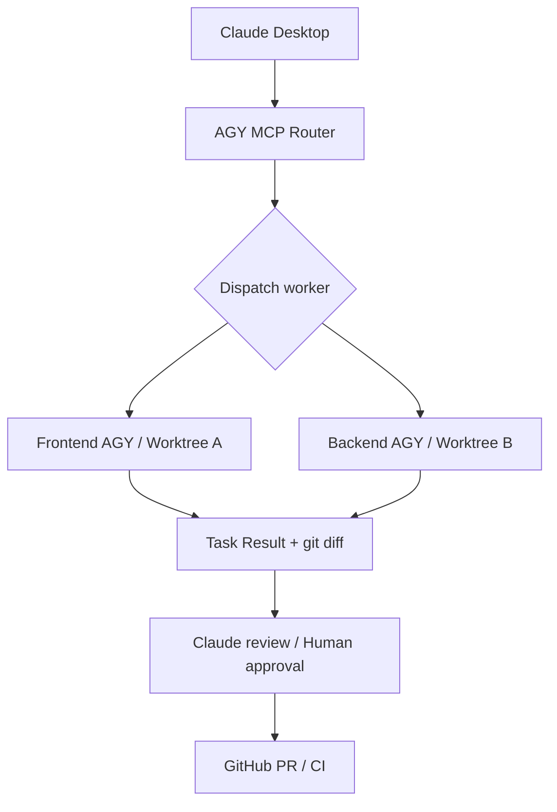

# AGY MCP Router — MVP v0.1

**Mục đích:** Claude Desktop giao task cho nhiều worker Antigravity CLI (`agy`), theo dõi trạng thái, nhận báo cáo và token usage; mỗi worker có thư mục làm việc Git riêng. Giao tiếp MCP qua stdio, không mở cổng mạng.

> Trạng thái: MVP tham khảo, **chưa chạy integration test với AGY thật và Claude Desktop trên máy của bạn**. Không phải sandbox bảo mật. Không kết nối production hay cấp credentials nhạy cảm cho worker.

## Thành phần

- `router.py`: local MCP Server bằng Python, SDK `mcp` v1.
- `config/workers.example.json`: cấu hình ID worker, executable, HOME và Git worktree, timeout.
- `.state/router.db`: SQLite task status, results (có thể chứa dữ liệu nhạy cảm; hạn chế ACL và không commit).
- `config/claude_desktop_config.example.json`: ví dụ nối vào Claude Desktop Windows.
- MCP tools: `list_workers`, `submit_task`, `get_task`, `list_tasks`, `cancel_task`.

## Cài đặt trên Windows 11

### 1. Kiểm tra CLI

```powershell
agy --version
agy -p "Reply READY" --output-format json
py -3 --version
git --version
```

### 2. Chuẩn bị môi trường

Giải nén thư mục thành `C:\AGY\router`, mở PowerShell:

```powershell
cd C:\AGY\router
powershell -ExecutionPolicy Bypass -File .\scripts\install-windows.ps1
```

Điều chỉnh đường dẫn trong `config\workers.json`. Tạo thư mục profiles:

```powershell
New-Item -ItemType Directory -Force C:\AGY\profiles\frontend, C:\AGY\profiles\backend
```

Ví dụ tạo Git worktree trên repository đã clone (thay path repo và commit base cho đúng):

```powershell
cd C:\Projects\hula-erp
git worktree add -b ai/frontend-001 C:\Projects\worktrees\hula-frontend-feature main
git worktree add -b ai/backend-001 C:\Projects\worktrees\hula-backend-feature main
```

Không giao cùng một Git worktree cho hai worker. **Không dùng worktree của production hoặc main/master.**

### 3. Kiểm tra authentication độc lập

AGY có thể lưu tokens trong **Windows Credential Manager**, không chỉ trong HOME. Vì vậy **HOME/USERPROFILE riêng không đảm bảo** mỗi worker có Google Account khác nhau. Cách được khuyến nghị cho production: chạy từng worker bằng **Windows OS user riêng** hoặc VM/container riêng (nếu keyring hoạt động và đăng nhập được trong VM/container đó). Bản MVP này tạo subprocess cùng OS user, vì vậy không cam kết tách account xác thực.

Trong PowerShell có thể kiểm tra profile, nhưng phải xác nhận thực tế account AGY nhận diện; không lấy số profile để suy ra số account:

```powershell
$env:HOME="C:\AGY\profiles\frontend"
$env:USERPROFILE="C:\AGY\profiles\frontend"
agy
agy -p "Reply READY" --output-format json
```

Với account thứ hai, thử trong cửa sổ riêng và kiểm tra identity có độc lập hay không. Nếu không độc lập, không tiếp tục mô hình chạy nhiều account trong cùng OS session.

### 4. Kết nối Claude Desktop

Mở `%APPDATA%\Claude\claude_desktop_config.json`, thêm nội dung `mcpServers.agy-router` từ `config/claude_desktop_config.example.json`. Giữ các entry MCP khác sẵn có; thay đường dẫn cho đúng. Thoát hoàn toàn và mở lại Claude Desktop.

### 5. Prompt kiểm tra

```text
Dùng list_workers để liệt kê worker. Giao frontend task: chỉ đọc module Sales Order và báo cáo các file liên quan (không sửa code). Dùng get_task để lấy kết quả; báo cáo cho tôi trước khi cho phép code.
```

MCP `submit_task` chạy bất đồng bộ, trả task_id ngay. Claude cần gọi `get_task` sau đó để kiểm tra tiến trình (hoặc theo dõi trong danh sách tasks). Không có cơ chế tự gửi thông báo khi job xong trong bản MVP.

## Các mức quyền / giới hạn bảo mật

- Router không sử dụng shell=True và không cho phép chọn thư mục tùy ý trong MCP call.
- Chỉ cho phép worker ở các worktree cấu hình sẵn và yêu cầu feature branch.
- Không truyền `--dangerously-skip-permissions`. AGY headless mặc định có thể từ chối shell commands cần phê duyệt. Muốn chạy build/test tự động phải cấu hình quyền hẹp của AGY theo tài liệu và đặt worker trong OS sandbox.
- **CẢNH BÁO:** Prompt yêu cầu không push/merge/deploy không phải enforcement. AGY vẫn có khả năng truy cập filesystem/network theo quyền OS user. Để đảm bảo chặn, dùng OS user/container/VM, ACL, network egress restrictions, GitHub token read-only, branch protection.
- Router chưa quản lý việc tạo worktree tự động, không có policy engine phê duyệt, chưa có realtime streaming; cấm production release ở mức quy trình.
- `.state/router.db` lưu prompt và response, không nên đưa secrets vào prompt.
- AGY trả JSON result với `status: SUCCESS`, `conversation_id`, `response`, `usage` theo tài liệu headless chính thức.

## Luồng đề xuất



## Test độc lập

```powershell
.\.venv\Scripts\python.exe -m unittest discover -s tests -v
```

Kiểm thử bao gồm parser, queue và mock AGY; cần kiểm tra thực tế xác thực, CLI, quyền và hành vi headless trước production.

## Tài liệu tham khảo

- [Google AGY headless](https://antigravity.google/docs/cli/headless/)
- [Google AGY CLI reference](https://antigravity.google/docs/cli/reference/)
- [Python MCP SDK](https://github.com/modelcontextprotocol/python-sdk)
