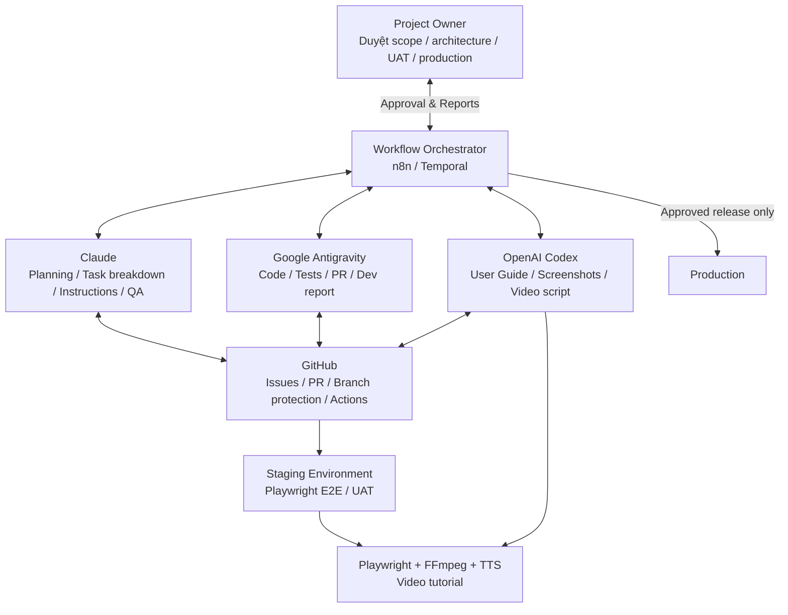
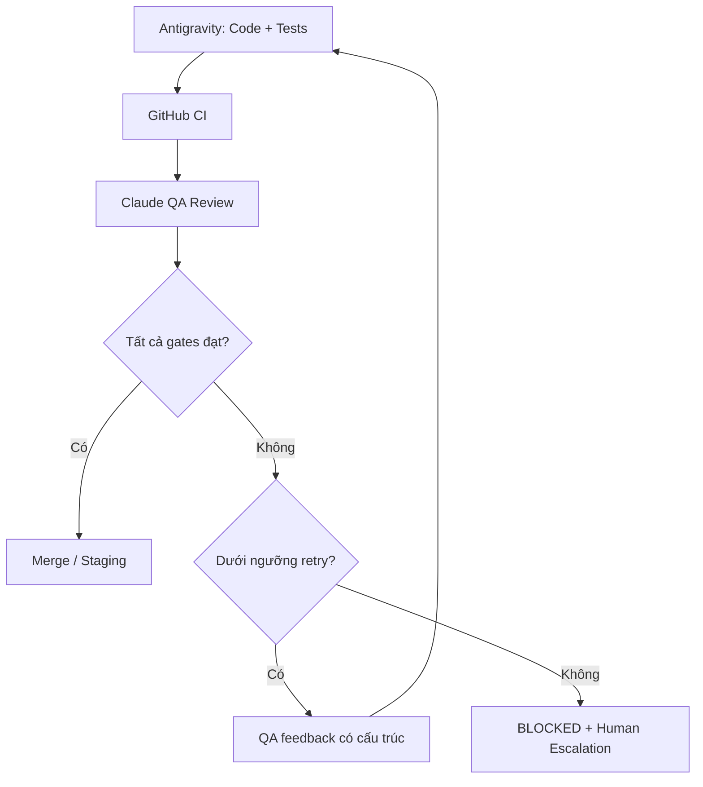

# ĐỀ XUẤT XÂY DỰNG AI DEV TEAM VỚI AUTOMATION WORKFLOW

**Phiên bản:** 1.0  
**Ngày:** 22/11/2026  
**Mô hình:** Claude + Google Antigravity + OpenAI Codex + Workflow Orchestrator + GitHub  
**Project Owner:** Người phụ trách phê duyệt những quyết định trọng yếu của dự án

---

## 1. Mục tiêu

Thiết lập **AI Dev Team** theo mô hình *Multi-Agent Software Development Lifecycle (Agentic SDLC)*, tự động hoá chu trình từ phân tích yêu cầu đến lập trình, kiểm thử, lập tài liệu, tạo video hướng dẫn và triển khai. Project Owner nhận báo cáo tập trung và chỉ duyệt những mốc quan trọng.

### Nguyên tắc

- **Claude:** AI Engineering Manager / Tech Lead / QA Lead.
- **Antigravity:** AI Software Engineer, thực thi các coding task.
- **Codex:** AI Technical Writer / Documentation & Training Agent.
- **Project Owner:** duyệt scope, kiến trúc trọng yếu, UAT và phát hành production.
- **Orchestrator:** điều phối các bước, lưu workflow state, audit log, retry và approval; không dùng lịch sử chat của AI làm nguồn trạng thái hệ thống.
- **GitHub:** nguồn sự thật cho source code, Issues, PR, review và CI/CD.

## 2. Sơ đồ kiến trúc



> **Lưu ý:** Sơ đồ thể hiện kiến trúc mục tiêu. Khả năng thực thi headless, xác thực và quyền của từng CLI/SDK cần được xác nhận trên môi trường triển khai thực tế trước khi vận hành không giám sát.

## 3. Phân vai và quyền hạn

| Vai trò | Trách nhiệm | Quyền đề xuất |
|---|---|---|
| Claude — AI Engineering Manager | Phân tích yêu cầu, PRD, kiến trúc, sprint, task breakdown, prompt giao việc, review và QA | Tạo issue, comment/review PR, đề xuất merge; tự động merge chỉ khi chính sách cho phép |
| Antigravity — AI Developer | Nhận task, checkout feature branch, code, unit test, commit, tạo PR và báo cáo | Ghi code trên feature branch; không push trực tiếp `main` |
| Codex — AI Documentation Agent | Đọc phiên bản đã xác thực; tạo User Guide, FAQ, changelog, video script, tài liệu hướng dẫn | Ghi thư mục docs qua nhánh riêng và tạo documentation PR |
| Orchestrator | Routing, webhook, state, retry, timeout, notifications, audit | Thực thi theo approval policy, không tự bỏ qua gate |
| Project Owner | Duyệt scope, quyết định kiến trúc trọng yếu, UAT, production release | Quyền phê duyệt cuối cùng ở các gate bắt buộc |

**Nguyên tắc bảo vệ:** Các kiểm soát branch protection, required reviewers và deployment environment phải được áp dụng ở GitHub/CI/CD, không chỉ ghi trong prompt của AI.

## 4. Workflow End-to-End (10 bước)

### Bước 1 — Project Intake / Claude

1. Project Owner nhập yêu cầu ngôn ngữ tự nhiên.
2. Claude tạo PRD, solution outline, acceptance criteria, risk register, backlog, dependency map.
3. Orchestrator lưu đầu ra có version và chuyển sang `AWAITING_SCOPE_APPROVAL`.

### Bước 2 — Approval Gate 1 / Project Owner

- Gửi tóm tắt scope, kiến trúc, chi phí dự kiến, rủi ro.
- Các quyết định: **Approve**, **Request Changes**, **Reject**.
- Nếu chưa approve, không dispatch coding task.

### Bước 3 — Task Assignment / Claude

- Chuyển backlog thành GitHub Issues.
- Xác định priority, dependencies, branch naming, acceptance criteria.
- Tạo instruction prompt/structured task contract cho Antigravity.

### Bước 4 — Development / Antigravity

- Nhận task contract, checkout feature branch trong workspace riêng.
- Code, chạy unit tests/lint/typecheck, commit, mở Pull Request.
- Đính kèm development report và test evidence.

### Bước 5 — QA & Review / Claude + GitHub CI

- GitHub Actions thực thi lint, tests, build, security checks.
- Claude đọc diff, acceptance criteria, security impact, code quality.
- Nếu lỗi: trả feedback có cấu trúc cho Antigravity và chạy vòng sửa.
- Giới hạn ví dụ: **3 lần sửa tự động**; nếu không đạt thì `BLOCKED` và báo Project Owner.

### Bước 6 — Merge & Staging / GitHub

- Chỉ merge khi CI và review đạt các quality gates.
- Nhánh `main` được bảo vệ, không có quyền bypass cho agent.
- Deploy staging, chạy smoke tests và end-to-end tests.

### Bước 7 — Documentation / Codex

- Nhận release candidate đã chạy ổn định trên staging.
- Tạo User Guide, FAQ, release notes, ảnh chụp theo nghiệp vụ thực tế.
- Tài liệu phải gắn version hoặc commit SHA của ứng dụng.

### Bước 8 — Video Tutorial / Codex + Playwright

- Codex viết storyboard, kịch bản, thứ tự thao tác và lời thoại.
- Playwright thực thi browser flows và quay màn hình.
- FFmpeg biên tập; tích hợp TTS/phụ đề nếu cần.
- Đầu ra: video MP4, captions/subtitles, script, artifact metadata.

> Codex đảm nhiệm **soạn kịch bản và điều phối công cụ tạo video**; không giả định Codex tự tạo được clip thao tác nếu thiếu trình duyệt được tự động hóa, recorder và công cụ dựng video.

### Bước 9 — Approval Gate 2 / Project Owner

Gửi bộ hồ sơ UAT:

- Staging URL và tài khoản thử nghiệm an toàn.
- Danh sách tính năng, PR links, test summary, known issues.
- User Guide và video demo.
- Risk summary, rollback plan và đề xuất release.

### Bước 10 — Production Release / CI/CD

- Sau phê duyệt hợp lệ: triển khai bằng GitHub Actions/deployment pipeline.
- Health checks, smoke tests và giám sát lỗi.
- Ghi release tag, changelog, deployment log và thông báo hoàn tất.
- Nếu health check thất bại, theo chính sách sẽ dừng và/hoặc rollback, đồng thời báo Project Owner.

## 5. Vòng lặp sửa lỗi tự động



Yêu cầu kỹ thuật: idempotency, lock theo repository/branch, timeout, retry với giới hạn, checkpoint, rollback, event history và audit trail.

## 6. Công nghệ đề xuất

| Hạng mục | Công nghệ | Mục đích |
|---|---|---|
| Orchestration | n8n trước; cân nhắc Temporal khi workflow phức tạp | Webhooks, orchestration, approvals, state coordination |
| Planning & QA | Claude Code / Claude Agent SDK / GitHub integration | Plan, task routing, code review |
| Coding | Google Antigravity, dùng CLI/headless runner nếu khả dụng trên môi trường mục tiêu | Coding agent |
| Documentation | OpenAI Codex CLI/SDK | User documentation, guides, scripts |
| Source control | GitHub | Repo, Issue, PR, rulesets |
| CI/CD | GitHub Actions | Build, test, artifact, staging/production deployment |
| Browser test & recording | Playwright | E2E, browser automation, screenshots, video recording |
| Video processing | FFmpeg + TTS | Video assembly, captions, narration |
| Data persistence | PostgreSQL | Jobs, agent runs, approvals, policies, audit records |
| Reporting | Microsoft Teams / dashboard | Project reporting, approvals, alerts |
| Reverse proxy | Nginx Proxy Manager | HTTPS ingress, access control |

### Kiểm chứng trước khi áp dụng

- CLI/headless mode thực tế và exit codes của Antigravity.
- Auth/API license và quota/chi phí riêng cho từng agent.
- Có thể chạy trong sandbox không tương tác hay không; cần xử lý thế nào khi agent yêu cầu permission.
- Codex có thể thao tác Playwright trong môi trường được cấu hình và xuất artifact đúng định dạng.
- GitHub App / fine-grained token scopes, OIDC, status checks và required reviewers.

## 7. Ma trận Human Approval

| Hoạt động | Phương án mặc định | Chính sách |
|---|---|---|
| Duyệt PRD và scope | Project Owner | Bắt buộc |
| Thay đổi kiến trúc lớn / migration DB | Project Owner | Bắt buộc |
| Giao task, coding, unit tests | AI | Tự động |
| QA và merge tính năng thông thường | AI + CI | Chỉ khi đầy đủ branch rules và không vượt risk policy |
| Authentication, authorization, secrets, production data | Project Owner | Bắt buộc |
| Tạo docs, FAQ, tutorial | AI | Tự động; kiểm tra chất lượng trước phát hành |
| UAT sign-off | Project Owner | Bắt buộc |
| Production deployment | Project Owner + CI/CD | Bắt buộc approval qua protected environment |

### Quy tắc bổ sung

1. AI không được thay đổi hoặc vô hiệu hóa policy/branch protection.
2. Không cấp production secrets cho coding agent.
3. Không dùng dữ liệu người dùng thật cho video hướng dẫn; phải có test data/anonymization.
4. Không triển khai production trực tiếp bằng lệnh shell của agent.
5. Approval phải lưu `approver_id`, `approval_id`, `timestamp`, `target_sha`, `decision` và `reason`.

## 8. Định dạng báo cáo Project Owner

Mỗi báo cáo nên gồm:

```yaml
project: HULA ERP
sprint: 04
status: AWAITING_UAT_APPROVAL
completed_tasks: 12
planned_tasks: 15
prs_passed_qa: 8
prs_total: 9
blocked_tasks: 1
staging_url: https://staging.example.invalid
release_candidate: v1.4.0-rc1
qa_summary:
  build: PASS
  unit_tests: PASS
  e2e_tests: PASS
  security_checks: PASS
artifacts:
  - user-guide.md
  - tutorial.mp4
approval_required:
  type: PRODUCTION_RELEASE
  allowed_decisions:
    - APPROVE
    - REQUEST_CHANGES
    - REJECT
```

**Chú ý:** Các chỉ số và đường dẫn ở trên chỉ là dữ liệu minh họa, không phải trạng thái một dự án thực tế.

## 9. Cấu hình AI DevOps Server tham khảo

| Tài nguyên | Khởi điểm |
|---|---|
| OS | Ubuntu Server 24.04 LTS |
| CPU | 8 vCPU |
| RAM | 16–32 GB |
| Disk | ≥200 GB SSD |
| Runtime | Docker Compose + isolated runners |
| Database | PostgreSQL |
| Ingress | HTTPS qua Nginx Proxy Manager; VPN cho admin |

Sizing cho khoảng 2–3 jobs đồng thời, **phụ thuộc vào kích thước repo, build/test workloads và số browser sessions**. Mỗi runner dùng workspace độc lập và quota tài nguyên; không gắn Docker socket đặc quyền trực tiếp vào tất cả agent.

## 10. Cấu trúc repository đề xuất

```text
ai-dev-team/
├── orchestrator/
│   ├── workflows/
│   │   ├── project-intake.json
│   │   ├── task-dispatch.json
│   │   ├── pr-review.json
│   │   ├── qa-loop.json
│   │   ├── docs-video.json
│   │   └── release-approval.json
│   └── policies/
│       └── approval-policy.yaml
├── agents/
│   ├── claude-manager/
│   │   ├── manager.md
│   │   ├── planner.md
│   │   └── reviewer.md
│   ├── antigravity-developer/
│   │   ├── developer.md
│   │   └── task-contract.md
│   └── codex-documentation/
│       ├── technical-writer.md
│       └── video-director.md
├── contracts/
│   ├── task.schema.json
│   ├── dev-report.schema.json
│   └── qa-report.schema.json
├── runners/
├── dashboards/
├── docker-compose.yml
└── README.md
```

## 11. Agent Task Contract

Để tránh giao việc bằng chat tự do, mỗi task phải có dữ liệu máy đọc được:

```json
{
  "task_id": "HULA-142",
  "repository": "org/hula-erp",
  "base_branch": "main",
  "base_commit": "<git-sha>",
  "feature_branch": "feat/hula-142-order-creation",
  "objective": "Implement order creation workflow",
  "requirements": ["Validate input", "Persist order", "Write unit tests"],
  "acceptance_criteria": ["API returns expected response", "All CI checks pass"],
  "allowed_paths": ["src/orders/**", "tests/orders/**"],
  "forbidden_paths": [".github/workflows/prod-deploy.yml", "infra/prod/**"],
  "expected_outputs": ["pull_request_url", "dev_report", "test_results"],
  "max_retries": 3
}
```

## 12. Project Knowledge Base

Duy trì tri thức dự án có version:

- `docs/architecture/` — system design và sơ đồ.
- `docs/adr/` — Architecture Decision Records.
- `docs/business-rules/` — các quy tắc nghiệp vụ.
- `docs/testing/` — test specifications và test data.
- `docs/agent-instructions/` — conventions và task templates.
- `docs/releases/` — changelog, release notes, approval records.

Claude và các agent phải đọc đúng phiên bản tài liệu tương ứng với task/release. Không dùng trí nhớ của model làm nguồn lưu quyết định chính thức.

## 13. Lộ trình triển khai

| Giai đoạn | Phạm vi | Deliverables | Exit criteria |
|---|---|---|---|
| MVP 1 | Claude → GitHub Issues → Antigravity → PR → Claude QA | Task contract, runner, CI, QA loop | 1 tính năng hoàn tất trên staging, không push trực tiếp main |
| MVP 2 | n8n + state DB + Teams approval | Workflow, notifications, human gates | Approval được ghi audit, workflow resume đúng trạng thái |
| MVP 3 | Codex + Playwright + FFmpeg | User Guide, screenshot, video automation | Artifact gắn đúng version, không lộ dữ liệu nhạy cảm |
| Production | Harden security, audit, dashboard, multi-project | Runbooks, dashboards, monitoring, backups | Pass UAT, rollback drill và security review |

### Pilot đề xuất: HULA ERP

Chọn một chức năng tương đối độc lập, có acceptance criteria rõ và dữ liệu thử nghiệm an toàn. Không nên thử lần đầu bằng migration schema dữ liệu production hoặc luồng thanh toán có rủi ro cao.

## 14. Rủi ro và biện pháp kiểm soát

| Rủi ro | Kiểm soát |
|---|---|
| AI hiểu sai yêu cầu | PRD và acceptance criteria có approval đầu vào |
| Prompt injection từ code, issue hoặc tài liệu | Treat repo contents as untrusted; sandbox, allowlist tool/action, giới hạn secrets |
| Agent tự ý sửa phần ngoài scope | `allowed_paths`, diff validation, GitHub protections |
| Lỗi lặp vô hạn / phát sinh chi phí | Retry limits, runtime limits, token/cost budgets |
| QA do chính AI đánh giá thiếu khách quan | Independent CI tests, deterministic checks, human UAT |
| Mất trạng thái workflow | Durable DB, idempotent jobs, event log |
| Lộ dữ liệu production trong clip | Staging fixtures, masking, review artifacts |
| Release hỏng | Protected deployment, smoke tests, backup, rollback plan |
| Tính năng vendor CLI/SDK thay đổi | Version pinning, integration tests, fallback runners |

## 15. Khuyến nghị cuối cùng

**Ưu tiên xây MVP bằng n8n + GitHub + Claude + Antigravity**, đảm bảo quy trình Coding → PR → QA → Fix Loop vận hành ổn định, sau đó tích hợp Codex để tạo tài liệu và video. Mục tiêu không chỉ là ba AI có thể trao đổi task, mà là một hệ thống **có kiểm soát, truy vết và có thể triển khai lặp lại**.

Đặc biệt, giữ Project Owner ở các approval gates trọng yếu, còn tác vụ thường nhật được tự động hóa và báo cáo dựa trên dữ liệu từ GitHub/CI thay vì tự khai báo bởi agent.

---

## 16. Tài liệu tham khảo chính thức cần kiểm tra khi triển khai

- Claude Code: https://docs.anthropic.com/en/docs/claude-code/overview
- Claude Code GitHub Actions: https://docs.anthropic.com/en/docs/claude-code/github-actions
- OpenAI Codex: https://developers.openai.com/codex/
- GitHub branch protection: https://docs.github.com/en/repositories/configuring-branches-and-merges-in-your-repository/managing-protected-branches
- GitHub deployment environments: https://docs.github.com/en/actions/reference/workflows-and-actions/deployments-and-environments
- Playwright video recording: https://playwright.dev/docs/videos
- n8n documentation: https://docs.n8n.io/
- FFmpeg: https://ffmpeg.org/documentation.html

Các URL là điểm bắt đầu tham khảo; cần kiểm tra lại phiên bản API, điều kiện sử dụng và tài liệu Antigravity CLI tương ứng trước khi xây runner production.
