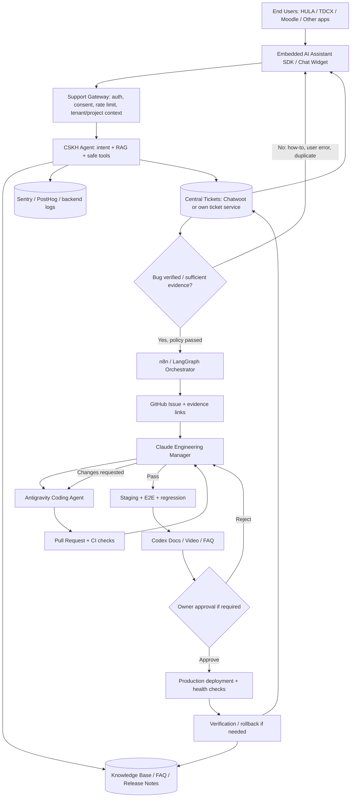

# AI PRODUCT SUPPORT → AI DEV TEAM → AUTOMATED RELEASE

**Phiên bản:** 1.1 – Phụ lục mở rộng cho `AI_Dev_Team_Automation_Proposal.md`  
**Ngày nghiên cứu:** 22/11/2026  
**Phạm vi:** Tích hợp AI Assistant trong nhiều sản phẩm, CSKH Agent, bug triage, GitHub, Claude Manager, Antigravity Developer, Codex Docs, approval và close-the-loop.

## 1. Mục tiêu

1. Mỗi sản phẩm có AI Assistant hỗ trợ end-user theo ngữ cảnh đăng nhập và quyền hạn.
2. Dồn tất cả yêu cầu về **Central AI Customer Support / Ticketing**.
3. CSKH Agent ưu tiên giải quyết bằng knowledge base, chẩn đoán an toàn, hướng dẫn và kiểm tra known issues.
4. Chỉ chuyển bug có bằng chứng và đạt tiêu chí sang GitHub/Claude Manager; hạn chế issue rác, trùng và prompt injection.
5. Vận hành vòng phát triển tự động: Claude lập task → Antigravity sửa code/test/PR → CI + Claude QA → staging → Codex cập nhật hướng dẫn/video → owner approval → production.
6. Đồng bộ trạng thái ngược về ticket, chủ động báo end-user và cập nhật tri thức để giảm ticket lặp lại.

## 2. Kiến trúc tổng thể



**System of record:** Tickets lưu yêu cầu khách hàng và trao đổi; GitHub lưu công việc engineering; Orchestrator lưu workflow và approvals; observability lưu bằng chứng; KB lưu tri thức đã nghiệm thu. Không coi nội dung chat AI là database trạng thái.

## 3. Mô hình agent và quyền

| Vai trò | Nhiệm vụ | Quyền được cấp | Không được phép |
|---|---|---|---|
| Embedded Assistant | Hướng dẫn, thu thập tình huống, hỗ trợ người dùng | Read KB, đọc trạng thái ticket của chính user | Truy cập dữ liệu tenant khác, gọi lệnh admin tùy ý |
| CSKH Agent / Support Manager | Classify, dedup, correlate logs, triage, tạo ticket, cập nhật khách | Ticket write, observability read theo scope, tạo draft issue | Trực tiếp commit code / deploy / mở secrets |
| Claude Engineering Manager | Xác minh task, ưu tiên, phân rã công việc, code review, QA | GitHub issue/PR, đọc repo, CI report; merge theo policy | Bypass branch protection hoặc tự duyệt release trọng yếu |
| Antigravity Developer | Sửa code, test, tạo PR, báo cáo | Feature branch workspace, sandbox runtime | Push trực tiếp main, truy cập production secrets |
| Codex Docs Agent | User guide, help center, release notes, kịch bản/clip | Docs branch, staging test account, video rendering | Đăng tài liệu mô tả chức năng chưa nghiệm thu |
| Project Owner | Quyết định scope, release nhạy cảm, production | Approval có audit trail | Không cần duyệt mọi issue hoặc commit nhỏ |

## 4. Luồng nghiệp vụ từ người dùng tới bug fix

1. **User context:** Widget gửi `product_id`, `tenant_id`, `app_version`, `page_url`, `session_id`, `correlation_id`, locale, role và thông tin môi trường đã được cho phép; backend xác thực mọi claim.
2. **AI first response:** Agent tìm KB theo product/version/role, đề xuất thao tác an toàn; không tự ý thay đổi dữ liệu, chính sách, giá cả hoặc quyền tài khoản.
3. **Collect evidence:** Chỉ yêu cầu ảnh/video khi cần; lấy exception, API trace, Sentry event, replay URL được cấp phép; loại bỏ token, mật khẩu, PII.
4. **Triage:** Xác định `how_to / user_error / bug / feature / billing / security`; gắn severity, confidence và bước tái hiện. AI đưa ra giả thuyết, không biến giả thuyết thành kết luận.
5. **Duplicate grouping:** So sánh normalized stack fingerprint, release, endpoint, steps, symptoms, tenant impact; liên kết vào issue cũ thay vì tạo issue mới.
6. **Bug submission:** Nếu bằng chứng đạt mức tối thiểu và policy cho phép, mở GitHub Issue với acceptance criteria; nếu không đủ, trạng thái `NEEDS_INFO`, gửi câu hỏi chính xác tới user.
7. **Claude intake:** Kiểm tra mức ưu tiên và phát triển test tái hiện trong sandbox; các security issue được định tuyến riêng.
8. **Development loop:** Claude giao task cho Antigravity → PR → CI + security check + Claude review → sửa lại nếu fail. Giới hạn số vòng retry và escalations.
9. **Staging validation:** QA chạy regression, E2E, test theo user role/tenant; Codex xây dựng docs/video từ staging bản đã pass.
10. **Approval/release:** Production được bảo vệ bằng branch rules, release environment và required reviewers phù hợp.
11. **Post-deploy verification:** So sánh error rate, replay/test confirmation. Nếu thất bại thì rollback và mở lại incident.
12. **Close-loop:** Ticket chuyển `RESOLVED_PENDING_CONFIRMATION`; gửi thông báo bằng ngôn ngữ thân thiện, cho user xác nhận, sau đó đóng và cải tiến KB.

## 5. Trạng thái cần quản lý

`NEW → AI_ASSISTING → NEEDS_INFO / RESOLVED_BY_SUPPORT / TRIAGED → DUPLICATE_LINKED / READY_FOR_ENGINEERING → IN_PROGRESS → PR_OPEN → QA_FAILED / QA_PASSED → STAGING_VERIFIED → AWAITING_APPROVAL → RELEASED → PENDING_USER_CONFIRMATION → CLOSED`

Trạng thái ngoại lệ: `SECURITY_ESCALATED`, `BLOCKED`, `ROLLBACK`, `REOPENED`.

Mỗi transition lưu `actor`, `timestamp`, `reason`, `evidence`, `workflow_run_id` và `idempotency_key`; không chỉ lưu phần mô tả tự do của LLM.

## 6. Quy tắc phân loại và escalation

| Nhóm | Ví dụ | Hành động mặc định |
|---|---|---|
| How-to / FAQ | Không tìm thấy nút xuất báo cáo | AI hướng dẫn + dẫn nguồn theo đúng phiên bản |
| User error | Thiếu quyền được cấp hoặc nhập sai định dạng | Hướng dẫn và đề xuất người có quyền xử lý |
| Functional bug | API 500 khi lưu đơn hàng | Truy xuất telemetry → verify → engineering issue |
| Feature request | Muốn thêm trường xuất Excel | Tổng hợp theo backlog, owner phê duyệt roadmap |
| Billing/account | Yêu cầu hoàn tiền / reset quyền admin | Chuyển nhân sự có thẩm quyền, không tự động quyết định |
| Security/privacy | Nghi lộ dữ liệu giữa tenant | Private security incident, cảnh báo chủ hệ thống, không public GitHub Issue |

Severity tham khảo: `SEV1` ngừng hệ thống/ảnh hưởng dữ liệu; `SEV2` chức năng cốt lõi hỏng, nhiều user; `SEV3` lỗi giới hạn với workaround; `SEV4` nhỏ hoặc thẩm mỹ. Severity cần dựa trên impact và bằng chứng chứ không dựa vào lời lẽ khẩn cấp của người báo.

## 7. Khuyến nghị công nghệ và đánh giá lựa chọn

### Customer support front end

- **Chatwoot (ưu tiên pilot):** Có shared inbox, live chat, help center, AI agent và self-hosting. Nên dùng làm conversation/ticket inbox trung tâm, viết adapter nối workflow riêng; kiểm tra edition/license của tính năng cần dùng trước khi chốt.
- **ChatterMate (phương án nghiên cứu):** Open-source AI support, omnichannel, self-hosted, có cơ chế ticket từ chat hoặc webhook; đáng thử nghiệm nhưng cần đánh giá kỹ maturity, security, release cadence, ownership.
- **Custom Next.js Widget + Support Gateway:** Phù hợp khi muốn UX đồng bộ và nhiều sản phẩm dùng chung; chi phí build và bảo trì cao hơn. Có thể kết hợp widget tự viết với Chatwoot API.

### Orchestration

- **n8n:** Tối ưu MVP nhờ webhooks, HTTP API, approvals, connectors, notification. Có thể dùng như integration layer, không nên nhồi logic agent dài vào workflow node.
- **LangGraph:** Durable execution và human-in-the-loop cho triage nhiều bước, giữ state, resume sau lỗi hoặc chờ duyệt dài ngày.
- **OpenAI Agents SDK:** Handoffs, tools, guardrails, tracing; phù hợp xây AI CSKH có nhiều tools. Guardrail phải bảo vệ các thao tác thực tế tại service/API level; không chỉ dựa vào prompt.
- **PostgreSQL:** Lưu ticket mapping, state, approvals, outbox events, dedup keys. Dùng queue/worker riêng cho tải lớn.

### Observability và evidence

- **Sentry:** Exceptions, linked issues, feedback, replay context và GitHub integration.
- **PostHog:** Product analytics, session replay, user path, feature flags. Nên chọn bổ sung theo yêu cầu, tránh lưu trùng dữ liệu nhạy cảm ở cả hai nền tảng.
- **OpenTelemetry:** Correlation giữa frontend request và backend service; chuẩn hóa `trace_id`/`request_id` trong ticket.
- **Playwright:** Reproduce/E2E, quay màn hình test; FFmpeg/TTS dùng để dựng tutorial. Không xem video tạo ra là tài liệu chính thức trước bước review.

## 8. Multi-product & tenant isolation

Thiết lập Product Registry:

```yaml
products:
  - product_id: hula-erp
    display_name: HULA ERP
    repository: org/hula-erp
    docs_collection: hula-erp
    support_inbox: hula-erp
    telemetry_project: hula-erp
    staging_url: https://staging.example.internal
    approval_policy: standard
  - product_id: tram-dung-cam-xuc
    display_name: Tram Dung Cam Xuc
    repository: org/tdcx
    docs_collection: tdcx
    support_inbox: tdcx
    telemetry_project: tdcx
    approval_policy: standard
```

Các ví dụ `org/...`, URL staging là **placeholder, cần cấu hình thực tế**. Không map repository chỉ từ lời user hoặc query parameter không xác thực. Tenant/user scope phải được xác định phía server; RAG index và observability query phải có filter bắt buộc.

### Kế hoạch tích hợp pilot

1. **HULA ERP:** hỗ trợ các nghiệp vụ SO, BOM, PO, XNT; kiểm tra API lỗi khi lưu chứng từ, phân quyền, trạng thái đơn; giới hạn truy cập theo đơn vị và vai trò.
2. **Trạm Dừng Cảm Xúc:** trợ lý onboarding, FAQ chức năng, gửi feedback/bug, xử lý lỗi UI và chức năng; tuyệt đối không xem nội dung hội thoại nhạy cảm là tài liệu debug mặc định.
3. **Moodle 5.1:** hỗ trợ học viên/giảng viên về login, nộp bài, điểm và thao tác LMS. Tránh gửi dữ liệu bài làm/điểm cá nhân vào issue công khai.
4. **Các Next.js/React apps khác:** dùng một shared `support-widget` SDK với `product_id`, `release_version`, authenticated context và backend adapter.

## 9. Hợp đồng dữ liệu: Bug Intake

```json
{
  "schema_version": "1.0",
  "ticket_id": "SUP-2026-000123",
  "product_id": "hula-erp",
  "tenant_id": "tenant-internal-id",
  "reporter_user_id": "user-internal-id",
  "category": "bug",
  "severity": "SEV3",
  "confidence": 0.91,
  "title": "Saving sales order returns HTTP 500",
  "environment": {"app_version": "1.4.0", "browser": "Chrome", "page": "/sales-orders/new"},
  "expected_behavior": "Sales order is persisted and success message appears",
  "actual_behavior": "HTTP 500, changes not saved",
  "steps_to_reproduce": ["Create order in test tenant", "Fill required fields", "Select Save"],
  "evidence": {"sentry_issue_url": null, "trace_id": "trace-123", "redacted_log_ref": "evidence/123"},
  "duplicate_of": null,
  "status": "READY_FOR_ENGINEERING",
  "requires_human_review": false,
  "idempotency_key": "hula-erp:normalized-fingerprint:1.4.0"
}
```

Không đẩy `tenant_id`, `reporter_user_id` hoặc log nhạy cảm nguyên trạng vào public issue; nên thay bằng references an toàn trong hệ thống nội bộ. JSON là **contract minh họa** và cần schema validation, versioning, giới hạn kích cỡ, data retention.

## 10. Triggers / Events chính

- `support.conversation.created`
- `support.intent.classified`
- `support.bug.evidence_ready`
- `support.bug.duplicate_found`
- `engineering.issue.created`
- `github.pull_request.opened`
- `github.check_suite.completed`
- `release.staging_verified`
- `release.owner_approved`
- `release.production_verified`
- `support.ticket.user_confirmed`

Events dùng webhook signature, replay protection, retries với exponential backoff và dead-letter queue. Kiểm soát duplicate bằng `idempotency_key` và transaction/outbox pattern.

## 11. Quy tắc phê duyệt đề xuất

**AI tự động:** trả lời how-to; truy vấn log read-only sau khi kiểm tra scope; tạo/ghép ticket; tạo GitHub Issue trong repo cho phép; coding trên feature branch; chạy CI; cập nhật tài liệu dạng PR.

**Yêu cầu duyệt của Owner hoặc người có thẩm quyền:** scope/feature mới; thay đổi DB phá vỡ tương thích; auth/roles/secrets; ảnh hưởng quyền riêng tư hoặc thanh toán; destructive migrations; release production quan trọng; phản hồi sự cố bảo mật.

**Không cho phép:** LLM thực thi command của end-user trong môi trường thực; đọc secrets production; tự đóng security incident không có xác minh; auto-merge khi CI fail; bypass GitHub branch protections.

## 12. KPI / SLO pilot

- AI resolution rate cho FAQ có nguồn; tỷ lệ trả lời sai cần human correction.
- Ticket-to-valid-issue conversion rate, tỷ lệ issue trùng.
- Time to first response, triage time, time to verified fix.
- Defect escape rate sau deploy; reopen rate.
- User confirmation rate, CSAT, SLA theo severity.
- Cost per resolved ticket, token/run cost, CI minutes, runner utilization.

KPI phải lấy baseline thực tế trước khi đặt mục tiêu; không hứa một tỷ lệ automation hay SLA cố định khi chưa có dữ liệu.

## 13. Roadmap triển khai

**Phase 0 — Security and contracts:** Product Registry, tenant identity, policy, issue templates, evidence redaction, approval matrix.

**Phase 1 — End-user support MVP:** Cài widget lên HULA ERP, Chatwoot inbox, KB/RAG phiên bản hóa, CSKH Agent trả lời có nguồn, human handoff.

**Phase 2 — Engineering bridge:** Sentry integration, triage/dedup, ticket → GitHub Issue, Claude task intake; chưa auto deploy.

**Phase 3 — Autonomous fix loop:** Antigravity isolated runner, PR + CI, Claude QA, staging tests, approval.

**Phase 4 — Documentation and closing loop:** Codex tạo guides/video, publish KB, user notification, confirmation/reopen.

**Phase 5 — Multi-product scale:** TDCX, Moodle, centralized dashboards, queue, SLO, RBAC, audit, cost governance.

## 14. Các rủi ro phải xử lý trước production

1. **Prompt injection:** End-user text, screenshot OCR, repository comments và log đều là untrusted input; quyền thực thi được kiểm soát bên ngoài LLM.
2. **Privacy:** user consent, masked replay, PII redaction trước khi gửi model bên ngoài; retention phù hợp từng sản phẩm.
3. **Cross-tenant leaks:** Product Registry server-side, token scoping, RBAC/ABAC, tenant-bound DB row policies và test isolation.
4. **Bad automated fix:** Test tái hiện độc lập, regression tests, staging gate, canary, metrics + rollback.
5. **Workflow reliability:** dedup, idempotency, retry bounded, dead-letter, alert cho block, audit traces.
6. **AI CSKH hallucination:** chỉ trả lời nghiệp vụ khi có nguồn KB đủ tin cậy; nếu không chắc thì chuyển chuyên viên.
7. **Video/tutorial inaccuracies:** hướng dẫn sinh từ staging phải được kiểm chứng với đúng release, đúng role và dữ liệu demo.

## 15. Các project/tài liệu tham khảo đã đối chiếu

- Chatwoot: https://www.chatwoot.com/ — shared inbox, help center, AI support, self-hosted.
- ChatterMate: https://github.com/chattermate/chattermate.chat — nền tảng AI customer support mã nguồn mở.
- Chatwoot + Claude integration demo: https://github.com/A-Locke/ai-game-support-platform — mẫu tham khảo community, không đồng nghĩa production-ready.
- LangGraph: https://github.com/langchain-ai/langgraph — durable agent execution và human-in-the-loop.
- OpenAI Agents SDK: https://developers.openai.com/api/docs/guides/agents/sdk — handoffs, tools, tracing, guardrails.
- Sentry integrations: https://sentry.io/integrations/ — issue tracking và observability.
- Sentry CLI: https://cli.sentry.dev/commands/issue/ — lấy ngữ cảnh issue/event.
- PostHog session replay: https://posthog.com/docs/session-replay — replay và privacy controls.
- GitHub REST Issues API: https://docs.github.com/en/rest/issues/issues — tạo issue bằng quyền Issues write.
- n8n: https://docs.n8n.io/ — workflow automation.

**Kiến nghị cuối:** pilot một luồng HULA ERP từ user chat báo lỗi lưu đơn hàng đến ticket chuẩn hóa và GitHub Issue; chỉ khi khả năng phân loại/dedup và bảo vệ dữ liệu đạt yêu cầu mới bật tự động chạy coding agent và release gates. Giữ toàn bộ hệ thống dưới quyền Owner, không trao quyền triển khai production chỉ dựa vào đánh giá của một LLM.
